# 4.1 [A-D変換の実習I]
## 結果報告(1)
### 4.1.3
||4bit|4bit表示|8bit|8bit表示|
|---|---|---|---|---|
|+1|1.294|00100000|1.053|00011010|
|基準|1.020|00010000|1.018|00011001|
|-1|0.621|00000000|0.981|00011000|

各符号化ビット数について、インジケータが基準値から+1および-1となった電圧の差を求めると次のようになった。

|符号化ビット数|+1の電圧 [V]|-1の電圧 [V]|電圧差 [V]|
|---:|---:|---:|---:|
|8bit|1.053|0.981|0.072|
|4bit|1.294|0.621|0.673|

### 4.1.5
#### 8bit
||10進数|2進数|+1|基準|-1|差<(+1)-(-1)>|
|---|---|---|---|---|---|---|
|田崎|71|01000111|2.874|2.852|2.815|0.059|
|石倉|8|00001000|0.3613|0.3412|0.3010|0.0603|
|宮野|105|01101001|4.29|4.26|4.23|0.06|
|黄|38|00100110|1.575|1.558|1.518|0.057|

**項目(5)の平均：0.059075 V**

#### 4bit
||10進数|2進数|+1|基準|-1|差<(+1)-(-1)>|
|---|---|---|---|---|---|---|
|田崎|71|01000111|未測定|未測定|未測定|未測定|
|石倉|8|00001000|5.81|5.57|5.14|0.67|
|宮野|105|01101001|未測定|未測定|未測定|未測定|
|黄|38|00100110|未測定|未測定|未測定|未測定|

**項目(5)の平均：0.67 V（測定済み1件のみの暫定値）**

項目(3)、(4)、(5)で得られた電圧差をまとめると、8bitでは $0.072, 0.059, 0.0603, 0.060, 0.057$ Vの5件、4bitでは $0.673, 0.67$ Vの2件が得られた。したがって、測定済みデータだけを用いた平均は次のとおりである。

|符号化ビット数|平均の対象|全測定値の平均 [V]|
|---:|---|---:|
|8bit|5件|0.06166|
|4bit|2件|0.6715（暫定）|

4bitについては田崎、宮野、黄の項目(5)が未測定であるため、0.6715 Vは班全員の平均ではない。

石倉の基準電圧が8bitでは0.3412 V、4bitでは5.57 Vと大きく異なるのは、基準としたインジケータの表示が異なるためである。  
4bitモードでは上位4ビット（$2^7$～$2^4$）しか変化せず、下位4ビットは常に0となるため、学生番号の2進表現00001000をそのまま表示させることはできない。  
そこで4bitでは、下位4ビットの `1000` を上位4ビットに表示させた状態（10000000、8bit換算で128）を基準とした。128/256はフルスケールの約半分であり、5.57 Vはこれに対応する。

## 結果報告(2)
まず、8bitの1コード当たりの電圧を、離れたコード間の基準電圧の差から求める。  
宮野（105）と石倉（8）の基準電圧の差は $4.26-0.3412=3.919$ Vで、コード差は97なので、1コード当たり $3.919/97\simeq0.0404$ Vとなる。  
これより、ユニポーラのフルスケールは約 $0.0404\times256\simeq10.3$ Vと見積もられる。  
この値を用いると、理論上の量子化幅は8bitで約0.040 V、4bitで $10.3/16\simeq0.65$ Vとなる。  
丸めを仮定した最大量子化誤差は量子化幅の半分なので、8bitでは約0.020 V、4bitでは約0.32 Vである。

一方、電圧を上げて+1になった電圧と下げて−1になった電圧の差は、全測定値の平均で8bitが0.06166 V、4bitが0.6715 Vであった。  
4bitの実測値は理論値約0.65 Vに近いが、8bitの実測値は理論値約0.040 Vより約0.02 V大きい。  
そのため、実測値の比は $0.6715/0.06166\simeq10.9$ 倍となり、理論上の16倍より小さかった。

8bitの1コード当たりの電圧は、離れたコード間から求めると約0.040 Vで理論どおりであった。  
したがって、+1と−1の電圧差が大きく出たのは量子化幅そのものの違いではなく、測定方法によるものと考えられる。  
電圧を上げる場合と下げる場合で比較器の切換え電圧がずれるヒステリシスや、電圧設定の刻み・テスタの分解能、遷移付近の雑音による揺らぎは、  
ビット数によらずほぼ一定の上乗せ（約0.02 V）として電圧差に加わる。  
この上乗せは量子化幅0.65 Vの4bitでは数%にすぎないが、0.040 Vの8bitでは約50%に相当する。  
このため8bitの実測値だけが理論値より大きくなり、比が16倍より小さくなったと考える。

# 4.2 [A-D変換の実習II]
## 結果報告(1)
||10進数|2進数|入力電圧 [V]|
|---|---|---|---|
|田崎|71|01000111|-2.288|
|石倉|8|00001000|-4.85|
|宮野|105|01101001|-0.918|
|黄|38|00100110|-3.645|
## 結果報告(2)
まず、用語としてユニポーラ／バイポーラは下記のような意味を持つ。  

---
### ユニポーラ
基準となる0Vから正方向など、一方の極性の電圧のみをA-D変換する方式
### バイポーラ
バイポーラというのは、あるリファレンス・レベルに対して信号が上下に振れることを意味しています。

**出典：参考文献[7]**

---

まず、今回の測定値から1コード当たりの電圧を求める。宮野（105）と石倉（8）のコード差97に対し、  
ユニポーラ（4.1）では $(4.26-0.3412)/97\simeq0.0404$ V、バイポーラ（4.2）では $(-0.918-(-4.85))/97\simeq0.0405$ Vであった。  
したがって、本装置ではユニポーラとバイポーラの量子化幅はほぼ等しく、違いは入力範囲（ユニポーラ約0～10 V、バイポーラ約−5～+5 V）の置き方にある。

0 V以上の直流入力を測定する場合はユニポーラを選択する。  
ユニポーラでは256コードすべてを正電圧に割り当てられるのに対し、バイポーラでは正電圧側に使えるコードは約半分の128コードしかない。  
そのため、同じ量子化幅でも、ユニポーラは正側で測定できる最大電圧が約2倍（約10 V）となり、5 Vを超える正の直流電圧もクリップせずに変換できる。

一方、0 Vを中心として正負に変化する交流電圧にはバイポーラを選択する。  
交流信号をユニポーラで変換すると負の半周期を表現できず、出力が0 V付近へ張り付いて波形がクリップされる。  
したがって、正電圧だけを扱う直流信号にはユニポーラ、0 Vをまたぐ交流信号にはバイポーラが適している。

# 4.3 [A-D変換の実習III]
## 結果報告(1)
1. 石倉  

1. 田崎  
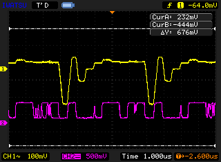

1. 宮野  
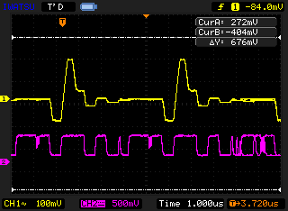

1. 黄  
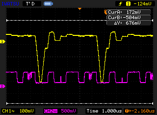

## 結果報告(2)
保存した4枚の波形は、いずれもCH1がD-A変換器出力（TP5）、CH2が比較器出力（TP8）であり、サンプル／ホールド制御信号（TP3）は記録されていない。  
そのため、今回保存した波形だけからサンプル期間の開始・終了を特定することはできず、サンプル時間とA-D変換時間を分けた実測値は**未測定**である。

ただし、D-A変換器出力は1回の変換ごとに同じ形を繰り返すため、その繰返し周期は保存波形から測定できる。  
4枚の波形はいずれも1.000 μs/divであり、D-A出力が大きく落ち込む位置の間隔は4人とも約5.0 div、すなわち約5.0 μsであった。  
これはサンプル時間とA-D変換時間を合わせた1回の変換周期の実測値に当たる。

取扱説明書の仕様および図2-1-4では、サンプル／ホールド回路のアクイジション時間が約0.5 μs、A-D変換時間が約4.5 μs、両者を合わせた最小サンプリング周期が約5 μsと示されている。  
これらの内訳は今回の実測値ではなく装置の参考値であるが、合計の約5 μsは上で測定した変換周期約5.0 μsと一致した。この変換周期から求めた最大サンプルレートは次のとおりである。

$$
f_s=\frac{1}{0.5\times10^{-6}+4.5\times10^{-6}}=2.0\times10^5\ \mathrm{Sample/s}
$$

## 結果報告(3)
D-A変換器出力は、逐次比較レジスタが最上位ビット $2^7$ から最下位ビット $2^0$ までを順番に仮決定した値をアナログ電圧へ変換したものである。  
比較器は、この試行電圧とサンプル／ホールドされた入力電圧を比較する。  
試行電圧が入力電圧以下であればそのビットを1として保持し、入力電圧を超えれば0に戻す。  
この操作を8回繰り返すことで最終的な8ビット値が決まる。

|氏名|10進数|8ビット表現|$2^7$|$2^6$|$2^5$|$2^4$|$2^3$|$2^2$|$2^1$|$2^0$|
|---|---:|---|---|---|---|---|---|---|---|---|
|田崎|71|01000111|取消|保持|取消|取消|取消|保持|保持|保持|
|石倉|8|00001000|取消|取消|取消|取消|保持|取消|取消|取消|
|宮野|105|01101001|取消|保持|保持|取消|保持|取消|取消|保持|
|黄|38|00100110|取消|取消|保持|取消|取消|保持|保持|取消|

逐次比較の原理から、各自の値に対してD-A変換器が順に出力する試行値と判定の流れを求めると次のとおりである。この表は波形から読み取った値ではなく、最終値から逆算した理論上の試行列である。

|氏名|D-A変換器が順に出力する試行値（K：保持、R：取消）|最終値|
|---|---|---:|
|田崎|128R → 64K → 96R → 80R → 72R → 68K → 70K → 71K|71|
|石倉|128R → 64R → 32R → 16R → 8K → 12R → 10R → 9R|8|
|宮野|128R → 64K → 96K → 112R → 104K → 108R → 106R → 105K|105|
|黄|128R → 64R → 32K → 48R → 40R → 36K → 38K → 39R|38|

例えば田崎の場合、最初の128の試行は入力を超えるため取り消され、64は保持される。  
その後96、80、72を順に取り消し、68、70、71を保持して01000111へ収束する。

保存波形では、約5 μsの変換周期ごとにD-A出力が大きく変化した後で一定値に落ち着き、その間に比較器出力が複数回反転していることを確認できた。  
これは、変換のたびに試行と比較を繰り返して最終値へ収束する逐次比較の動作と対応している。  
一方、CH1はAC結合（画面表示 `CH1∿`）、100 mV/divで観測しており、試行値の絶対電圧は読み取れない。  
例えば田崎では、試行値128と最終値71の差は約57コード（約2.3 V）に相当するが、画面上の振れは約0.4 Vにとどまる。  
さらに、8回分の段差を個別に見分けることもできなかった。したがって、上表の試行列を波形の各段差と1対1に対応付けることはできない。  
また、TP3を保存していないため、各判定の開始時刻をサンプル／ホールド制御信号に対して直接対応付けることもできない。

# 4.4 [D-A変換の実習I]
## 結果報告(1)
オシロスコープでは、CH2（紫）をA-D入力波形、CH1（黄）をD-A出力波形として観測した。

入力電圧 $V_{p-p}$ には、4.1(5)で求めた各自の基準電圧を用いた。  
石倉は4bitと8bitで基準電圧が異なるため、4bitでは5.57 V、8bitでは0.3412 Vを設定した。  
表の「画面上の入力振幅」は、CH2（紫）の山と谷の間隔を目盛（縦1 div）から読み取った値である。  
なお、画像中のカーソル（ΔY）は波形の山・谷に合わせておらず、前の測定の位置が残っているため使用しない。

|氏名|符号化ビット数|設定入力電圧 $V_{p-p}$ [V]|CH2の縦軸|画面上の入力振幅 [V]|表示／設定|
|---|---:|---:|---:|---:|---:|
|石倉|4bit|5.57|200 mV/div|約1.10|約0.20|
|石倉|8bit|0.3412|20 mV/div|約0.073|約0.21|
|田崎|8bit|2.852|200 mV/div|約0.56|約0.20|
|宮野|8bit|4.26|200 mV/div|約0.84|約0.20|
|黄|8bit|1.558|50 mV/div|約0.31|約0.20|

画面上の振幅は、すべての波形で設定値のほぼ0.2倍となった。比が一定であることから、観測点で入力が一定の比率で縮小されていると考えられるが、その原因は本実験では確認していない。

|氏名|4bit波形|8bit波形|
|---|---|---|
|石倉|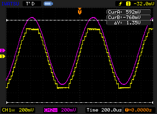|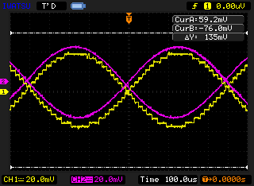|
|田崎|未測定|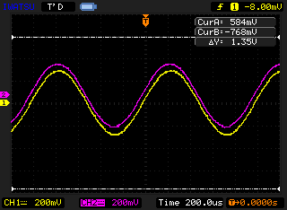|
|宮野|未測定|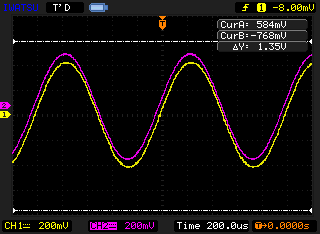|
|黄|未測定|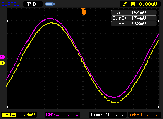|

田崎、宮野、黄の4bit正弦波は保存されていないため、推測で補わず未測定とした。  
このため、4bitと8bitを比較できるのは石倉のデータのみである。  
また、石倉の4bitと8bitは入力振幅（5.57 Vと0.3412 V、約16倍）および縦軸・横軸のスケールが異なるため、同一条件での比較ではない。

## 結果報告(2)
石倉の2枚の波形では、どちらもD-A出力（黄）が水平な段と縦の段差からなる階段状となった。  
段の縦方向の間隔はほぼ一定で、入力の傾きが小さい山・谷付近ほど各段の横幅が長い。これは振幅が一定の量子化幅ごとに丸められていることを示しており、量子化による階段と判断できる。

画面上で段差1段分の高さを読み取ると、次のとおりであった。

|符号化ビット数|縦軸|段差の間隔|画面上の量子化幅|
|---:|---:|---:|---:|
|4bit|200 mV/div|約0.32 div|約64 mV|
|8bit|20 mV/div|約0.2 div|約4 mV|

4bitと8bitの画面上の量子化幅の比は約 $64/4=16$ 倍であり、理論値 $2^8/2^4=16$ 倍と一致した。  
表示倍率はどちらも約0.2倍で共通なので、この比は入力電圧に換算しても変わらない。したがって、量子化幅と最大量子化誤差（量子化幅の半分）は4bitの方が8bitの16倍大きい。

一方、4bitの入力振幅は8bitの約16倍であったため、入力振幅に対する量子化幅の割合は4bitで約 $64/1100\simeq5.8$ %、8bitで約 $4/73\simeq5.5$ %となり、ほぼ同程度であった。  
2枚の波形の粗さが見た目では近いのはこのためである。同じ入力振幅で比較すれば、4bitでは段数が8bitの1/16となり、入力波形との誤差がはるかに大きくなる。

ただし、4bitの測定が石倉1人分しかないため、班員ごとの入力電圧による誤差の違いは比較できない。

# 4.5 [D-A変換の実習II]
## 結果報告(1)
CH2（紫）が入力正弦波、CH1（黄）がD-A出力波形である。

### サンプリング周波数1000 Hz（サンプリング周期1 ms）

|入力周波数|観測波形|
|---:|---|
|100 Hz|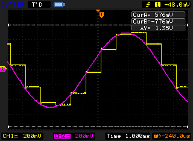|
|200 Hz|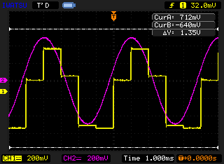|
|500 Hz|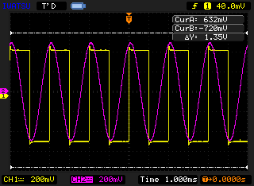|
|800 Hz|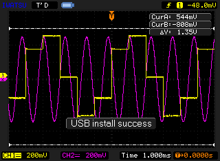|
|900 Hz|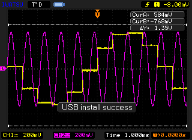|
|1000 Hz|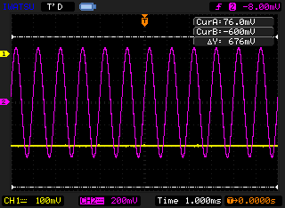|
|1100 Hz|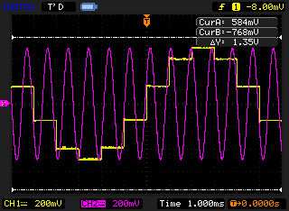|

### サンプリング周波数2000 Hz（サンプリング周期500 μs）

|入力周波数|観測波形|
|---:|---|
|100 Hz|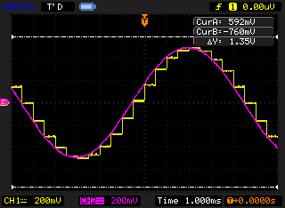|
|200 Hz|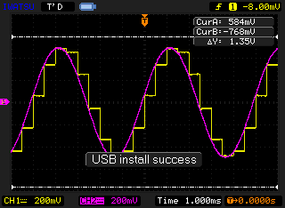|
|500 Hz|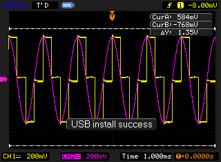|
|800 Hz|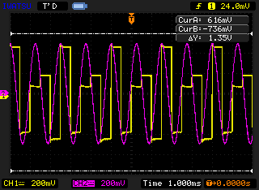|
|900 Hz|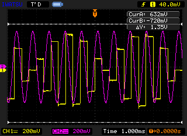|
|1000 Hz|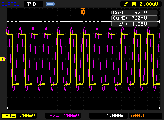|
|1100 Hz|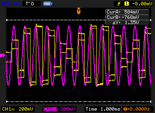|

## 結果報告(2)
標本化後に観測される周波数は、整数 $k$ を適切に選ぶと、ナイキスト周波数以下の範囲で次式により求められる。

$$
f_{alias}=|f_{in}-k f_s|,\qquad 0\leq f_{alias}\leq\frac{f_s}{2}
$$

|サンプリング周波数 $f_s$|入力周波数 $f_{in}$|D-A出力で現れる周波数|同じ波形となる組合せ|
|---:|---:|---:|---|
|1000 Hz|100 Hz|100 Hz|100 Hz、900 Hz、1100 Hz|
|1000 Hz|200 Hz|200 Hz|200 Hz、800 Hz|
|1000 Hz|500 Hz|500 Hz（ナイキスト周波数）|単独|
|1000 Hz|800 Hz|200 Hz|200 Hz、800 Hz|
|1000 Hz|900 Hz|100 Hz|100 Hz、900 Hz、1100 Hz|
|1000 Hz|1000 Hz|0 Hz（直流）|単独|
|1000 Hz|1100 Hz|100 Hz|100 Hz、900 Hz、1100 Hz|
|2000 Hz|100 Hz|100 Hz|単独|
|2000 Hz|200 Hz|200 Hz|単独|
|2000 Hz|500 Hz|500 Hz|単独|
|2000 Hz|800 Hz|800 Hz|単独|
|2000 Hz|900 Hz|900 Hz|900 Hz、1100 Hz|
|2000 Hz|1000 Hz|1000 Hz（ナイキスト周波数）|単独|
|2000 Hz|1100 Hz|900 Hz|900 Hz、1100 Hz|

このように、入力周波数が異なっていても標本点の並びが等しくなると、D-A出力から元の周波数を一意に決められない。  
例えば、$f_s=1000$ Hzでは900 Hzと1100 Hzはいずれも100 Hzとして現れ、200 Hzと800 Hzはいずれも200 Hzとして現れる。  
これがエイリアシング（折り返し）である。なお、波形の開始位相によって上下反転または時間方向のずれが生じる場合があるが、周波数は同じである。

観測波形でも、$f_s=1000$ Hz、$f_{in}=1000$ HzのときはCH1（黄）がほぼ一定電圧となり、表の0 Hz（直流）と一致した。  
また、900 Hzと1100 HzのCH1はいずれも約100 Hzのゆっくりした階段波となり、折り返し周波数の計算結果を実験で確認できた。

## 結果報告(3)
入力波形を忠実に再現するには、入力信号に含まれる最高周波数を $f_{max}$ としたとき、標本化定理を満たすように $f_s>2f_{max}$ とする必要がある。  
実際のローパスフィルタには遷移帯域があるため、等号ぎりぎりではなく十分に高いサンプリング周波数、すなわち短いサンプリング周期を選ぶべきである。  
また、標本化前にナイキスト周波数以上の成分を減衰させるアナログ・ローパスフィルタ（アンチエイリアシングフィルタ）を挿入する必要がある。

符号化ビット数は、必要な振幅分解能と許容できる量子化雑音から選ぶ。  
ビット数が多いほど量子化幅が小さくなり波形を忠実に表現できる一方、単位時間当たりのデータ量は増加する。  
したがって、対象信号の帯域に対して余裕を持ったサンプリング周波数と、要求される信号対雑音比を満たすビット数を選択することが重要である。

# 4.6 [音声信号の符号化および再生の実習]
## 結果報告(1)
符号化ビット数とサンプリング周期を変えて録音・再生したところ、次の傾向を確認した。

|符号化ビット数|サンプリング周期|サンプリング周波数|再生音の特徴|
|---:|---:|---:|---|
|8bit|20 μs|50 kHz|4条件の中で最も原音に近く、音声の輪郭が明瞭であった。|
|4bit|20 μs|50 kHz|音声の速さや高域は保たれるが、量子化雑音とざらつきが増えた。|
|8bit|500 μs|2 kHz|振幅の表現は比較的細かいが、高域成分が失われ、こもった不自然な音となった。|
|4bit|500 μs|2 kHz|高域成分の欠落と量子化雑音が同時に生じ、4条件の中で最も原音との差が大きかった。|

符号化ビット数を8bitから4bitへ減らすと量子化段階数は256段階から16段階へ減少し、量子化幅が16倍になる。  
このため、主として振幅方向の誤差が増え、雑音やひずみとして聞こえる。  
一方、サンプリング周期を20 μsから500 μsへ長くすると、サンプリング周波数は50 kHzから2 kHzへ低下する。  
標本化定理により2 kHz標本化で一意に扱える周波数は1 kHz未満となるため、音声の高周波成分が失われ、さらにアンチエイリアシングが不十分な場合には折り返しひずみも生じる。  
したがって、再生音の明瞭度には十分な符号化ビット数とサンプリング周波数の両方が必要である。

# 5 [事後レポート]
## (1) 背景・目的
現実の電圧や音声は時間・振幅ともに連続したアナログ信号であるが、コンピュータやディジタル通信装置で処理するには、
一定時間ごとに値を取り出す標本化、有限個の振幅値へ丸める量子化、数値を2進数で表す符号化が必要である。  
本実験の目的は、A-D／D-A変換装置を用いて、符号化ビット数、サンプリング周期、ユニポーラ／バイポーラ特性および逐次比較動作が変換結果へ与える影響を観測し、
量子化誤差とエイリアシングが生じる原理を理解することである。

## (2) 報告事項
各実験の報告事項は4.1～4.6に示した。

## (3) その他の報告
### ① 標本化定理とアンチエイリアシング
帯域制限されたアナログ信号を標本値から一意に復元するには、信号に含まれる最高周波数 $f_{max}$ の2倍より高い周波数で標本化する必要がある。

$$
f_s>2f_{max}
$$

標本化すると、入力周波数成分のスペクトルはサンプリング周波数 $f_s$ の整数倍ごとに複製される。  
$f_s/2$ を超える入力成分が存在すると、隣接する複製スペクトルが基底帯域へ重なり、$|f_{in}-k f_s|$ の低い周波数として現れる。  
これが折り返し、すなわちエイリアシングである。  
実験4.5では、$f_s=1000$ Hzのとき900 Hzと1100 Hzがともに100 Hzとして現れ、異なるアナログ信号が同一のディジタル標本列になり得ることを確認した。  
一度折り返された成分は本来の低周波成分と区別できないため、標本化後の処理だけでは除去できない。

この問題を防ぐため、A-D変換器の前段にアナログ・ローパスフィルタであるアンチエイリアシングフィルタを置き、ナイキスト周波数以上の信号と雑音を標本化前に減衰させる。  
理想フィルタと異なり、実際のフィルタには通過域から阻止域へ移る遷移帯域がある。  
そのため、$f_s=2f_{max}$ ちょうどではなく、遷移帯域を確保できるように入力帯域より十分高いサンプリング周波数を選び、阻止域で必要な減衰量が得られるフィルタ次数と遮断周波数を設計する必要がある。

### ② CD・DVD・携帯電話の標本化周波数と量子化ビット数

|用途|代表的な標本化周波数|量子化ビット数|方式・備考|
|---|---:|---:|---|
|音楽CD（CD-DA）|44.1 kHz|16bit|2チャンネルのリニアPCM|
|DVD-VideoのLPCM音声|48 kHzまたは96 kHz|16bit、20bit、24bit|非圧縮LPCMの場合。DVDでは圧縮音声が使われる場合もある|
|従来の電話音声（G.711系）|8 kHz|8bit|A-lawまたはμ-lawによる非線形PCM、64 kbit/s|
|携帯電話（AMR、狭帯域）|8 kHz|13bit|3G携帯電話などの音声。13bitの線形PCMを入力とし、AMRで圧縮して伝送|
|携帯電話（AMR-WB、広帯域）|16 kHz|14bit|VoLTEのHD音声など。14bitの線形PCMを入力とし、AMR-WBで圧縮して伝送|
|携帯電話（EVS）|8～48 kHz|16bit|VoLTEの高音質音声。帯域に応じて8、16、32、48 kHzを選択|

CDは人間の可聴上限をおよそ20 kHzとみなし、その2倍を上回る44.1 kHzで標本化している。  
DVD-VideoのLPCMは48 kHzまたは96 kHz、最大24bitを使用できるため、CDより広い帯域と細かい振幅分解能を扱える。  
従来の電話音声は会話に必要な帯域と伝送量を優先し、G.711では8 kHz・8bitを用いる。携帯電話では、マイク信号をまず表のような標本化周波数・ビット数の線形PCMへ変換した後、
AMR、AMR-WB、EVSなどの音声コーデックで圧縮して伝送する[8][9][10]。 
従来のAMRは電話と同じ8 kHz標本化で約3.4 kHzまでの音声を扱う。  
VoLTEで使われるAMR-WBは16 kHz標本化で約7 kHzまで、EVSは最大48 kHz標本化でさらに広い帯域を扱い、より自然な通話音声を実現している。

### ③ 本実験全体に関する考察
実験4.1および4.4から、符号化ビット数は振幅方向の分解能を決めることが分かった。  
8bitから4bitへ減らすと量子化段階数は256から16へ減少し、理論上の量子化幅と最大量子化誤差は16倍になる。  
実験4.4では、D-A出力波形の画面上の量子化幅が4bitで8bitの約16倍となり、理論と一致した。実験4.1の+1と−1の電圧差は約10.9倍にとどまった。  
しかし、離れたコード間から求めた8bitの1コード当たりの電圧は約0.040 Vで理論どおりであり、この差はヒステリシスなど測定方法による一定の上乗せで説明できる。

実験4.5および4.6から、サンプリング周期は時間方向の分解能を決めることが分かった。  
サンプリング周波数が入力帯域に対して不足すると、異なる入力周波数が同じ標本列となるエイリアシングが生じ、元の信号を一意に復元できない。  
音声実験でも、サンプリング周期500 μsでは2 kHz標本化となり、1 kHz以上の音声成分を正しく扱えないため、音がこもり不自然になった。  
また、実験4.3では逐次比較型A-D変換器の1回の変換に約5 μsかかることを確認した。この変換時間が、装置で設定できるサンプリング周波数の上限（約200 kSample/s）を決めている。

このように、量子化は振幅方向、標本化は時間方向の離散化であり、どちらか一方だけを細かくしても十分な再現性は得られない。  
高品質なA-D／D-A変換には、入力信号の極性に合ったユニポーラ／バイポーラ範囲、必要な信号対雑音比を満たすビット数、
入力帯域の2倍を十分に上回るサンプリング周波数、および適切なアンチエイリアシングフィルタを組み合わせる必要がある。  
一方で、ビット数とサンプリング周波数を高くするとデータ量と処理量も増えるため、用途に必要な品質とのバランスを考えて設計することが重要である。

# 参考文献
1. 株式会社デジタル・エレクトロニクス・システムズ『A-D・D-A変換実習装置 ITF-203B 取扱説明書 v3』pp.4–18, 45–57.
1. 横田康成『信号処理の基礎 情報工学レクチャーシリーズ 第7章 ディジタル化と離散フーリエ変換』森北出版, 2013年.
1. Analog Devices, [Why is an input filter necessary when digitizing a baseband signal?](https://www.analog.com/en/resources/faqs/FAQ_antialiasing_filter.html)（2026年10月26日閲覧）.
1. Library of Congress, [Linear Pulse Code Modulated Audio (LPCM)](https://www.loc.gov/preservation/digital/formats/fdd/fdd000011.shtml)（2026年10月26日閲覧）.
1. Panasonic, [用語解説：LPCM（リニアPCM）](https://av.jpn.support.panasonic.com/support/term/alphabet/lpcm.html)（2026年10月26日閲覧）.
1. ITU-T, [Recommendation G.711: Pulse code modulation (PCM) of voice frequencies](https://www.itu.int/rec/t-rec-g.711)（2026年10月26日閲覧）.
1. Analog Devices, [ADC/DACに関する用語集](https://www.analog.com/jp/resources/technical-articles/2022/07/16/07/04/types-of-adcs-and-dacs.html)（2026年10月26日閲覧）.
1. 3GPP TS 26.090, Mandatory Speech Codec speech processing functions; Adaptive Multi-Rate (AMR) speech codec; Transcoding functions.
1. 3GPP TS 26.190, Speech codec speech processing functions; Adaptive Multi-Rate - Wideband (AMR-WB) speech codec; Transcoding functions.
1. 3GPP TS 26.445, Codec for Enhanced Voice Services (EVS); Detailed algorithmic description.
