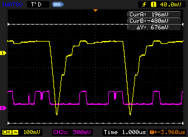

# 4.1 [A-D変換の実習I]
## 結果報告(1)
### 4.1.3
||4bit|4bit表示|8bit|8bit表示|
|---|---|---|---|---|
|+1|1.294|00100000|1.053|00011010|
|基準|1.020|00010000|1.018|00011001|
|-1|0.621|00000000|0.981|00011000|
### 4.1.5
#### 8bit
||10進数|2進数|+1|基準|-1|差<(+1)-(-1)>|
|---|---|---|---|---|---|---|
|田崎|71|01000111|2.874|2.852|2.815|0.059|
|石倉|8|00001000|0.3613|0.3412|0.3010|0.0603|
|宮野|105|1101001|4.29|4.26|4.23|0.06|
|黄|38|100110|1.575|1.558|1.518|0.057|

**平均 : 0.059075**

#### 4bit
||10進数|2進数|+1|基準|-1|差<(+1)-(-1)>|
|---|---|---|---|---|---|---|
|田崎|71|01000111|||||
|石倉|8|00001000|5.81|5.57|5.14|0.67|
|宮野|105|1101001|||||
|黄|38|100110|||||

**平均 : 0.67**

## 結果報告(2)
結果より符号化ビット数が8bitと4bitの場合の量子誤差を比べると4bitのほうが量子誤差が大きいことがわかる。  
これは4bitが表現できる状態数はわずか16段階(24)であるのに対し、8bitは256段階(28)を表現できる。  
これにより、同じ電圧や音量の範囲をデジタル化する場合、8bitのステップ幅は4ビットの16分の1まで細かくなる。
量子化誤差は「最大でもステップ幅の半分」に収まるため、ステップ幅が16分の1になるということは、  
切り捨てや四捨五入によって失われるデータの最大値（量子化誤差）も16分の1に抑えられることを意味すると考える。

# 4.2 [A-D変換の実習II]
## 結果報告(1)
||10進数|2進数|8bit|
|---|---|---|---|
|田崎|71|01000111|-2.288|
|石倉|8|00001000|-4.85|
|宮野|105|1101001|-0.918|
|黄|38|100110|-3.645|
## 結果報告(2)
まず、用語としてユニポーラ/ハイポーラは下記のような意味を持つ  

---
### ユニポーラ
基準となる0Vから正方向など、一方の極性の電圧のみをA-D変換する方式
### バイポーラ
バイポーラというのは、あるリファレンス・レベルに対して信号が上下に振れることを意味しています。

**出典 : Analog Devices, [ADC/DACに関する用語集](https://www.analog.com/jp/resources/technical-articles/2022/07/16/07/04/types-of-adcs-and-dacs.html?utm_source=chatgpt.com) (2002.07.22公開/20026.10.26閲覧)**

---

つまり上記意味より、直流の場合はユニポーラを選択し、交流の場合はバイポーラを選択すべきであると考える。

# 4.3 [A-D変換の実習III]
## 結果報告(1)
1. 石倉  

