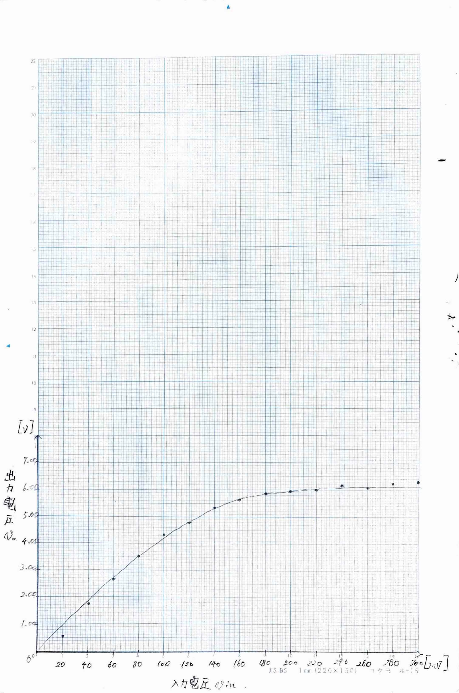
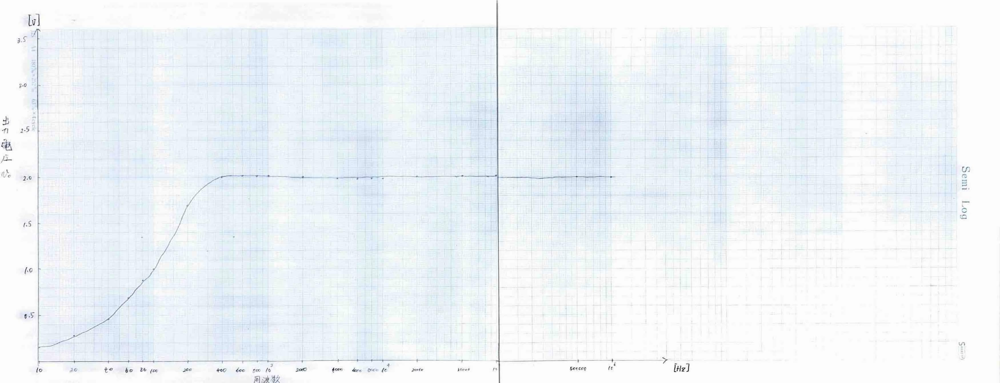

# 2)グラフ
|V in |V o |
|---|---|
|0mV    |0mV|
|20mV   |580mV|
|40mV   |1.76V|
|60mV   |2.68V|
|80mV   |3.56V|
|100mV  |4.32V|
|120mV  |4.80V|
|140mV  |5.32V|
|180mV  |5.84V|
|200mV  |5.92V|
|220mV  |6.00V|
|240mV  |6.16V|
|260mV  |6.24V|
|280mV  |6.24V|
|300mV  |6.32V|

# 3)グラフ
|周波数 |V0|
|---    |---|
|10Hz   |160mV|
|20Hz   |280mV|
|40Hz   |464mV|
|60Hz   |688mV
|80Hz   |880mV|
|100Hz  |1.02V|
|200Hz  |1.69V|
|400Hz  |2.00V|
|600Hz  |2.08V|
|800Hz  |2.08V|
|1kHz   |2.08V|
|2kHz   |2.06V|
|4kHz   |1.98V|
|6kHz   |1.98V|
|8kHz   |1.98V|
|10kHz  |1..98V|
|20kHz  |2.00V|
|50kHz  |2.02V|
|100kHz |2.06V|
|500kHz |2.00V|
|1MHz   |2.04V|

