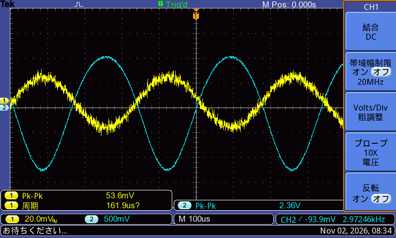
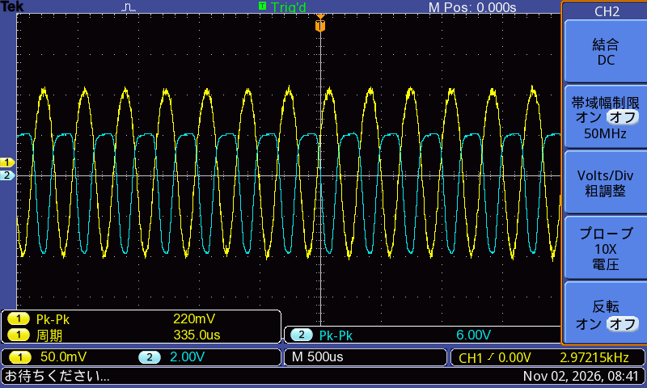

# 情報通信工学基礎実験 トランジスタ回路
- 25A5008 石倉圭人
## 1.測定データをレポート用紙に整理し、グラフを清書せよ
### 1. 入力電圧,出力電圧の観測
  
**図1:40mV**  
  
**図2:200mV**
### 2.入出力特性
別紙1.参照(**図3**)
### 3.周波数特性
別紙2.参照(**図4**)
## 2. 5.(1)の測定でつくられた波形と、図8のトランジスタの特性よりエられる波形を比較検討せよ
図8(a)の入力特性で vBE の変化を iB に変換し、図8(b)の出力特性と交流負荷線から vCE（＝vo）の波形を求めた。この波形を実測波形と比較した。

(a) vin = 40 mV
静特性から求めた出力は 2.32 V p-p、実測は 2.34 V p-p で、ほぼ一致した。どちらも入力と逆位相（180°）であった。  
入力特性が指数関数的に曲がっているため、iC が増える負側の振幅がわずかに大きく、小振幅でも少しひずみが見られた。

(b) vin = 200 mV                  
静特性からは、入力の負側で遮断し、正側で飽和するため、上下がクリップした台形状の波形になると予想される。  
実測も台形状で、p-p 値は予想 6.35 V、実測 6.00 V と近かった。
Q 点が交流負荷線の中央にないため、クリップ電圧は遮断側 +2.36 V、飽和側 −4.09 V と非対称になる。  
一方で、実測では遮断側の平らな部分が広いなど、波形の細かい形は予想と異なった。原因として、ベース電流が流れて入力波形自体がつぶれたこと、コンデンサの充電で動作点がずれたこと、素子のばらつきが考えられる。
  
## 3. 5.(2)の測定結果より、制作した回路の電圧像h熟度を求めよ.また、事前レポートでまとめた理論値と比較検討せよ
Ans.   
- 比        1.64倍
- 相対誤差  63.8%
- 差        +4.2 dB

(途中式場別紙3.参照)

発生した差の主な原因は、hie の求め方にあると考えられる。事前レポートでは、vBE = 0.5 V と 0.6 V の2点を結んだ割線の傾きから hie を求めた。しかし入力特性は指数関数的に曲がっているため、この方法では動作点 Q（IBQ ≒ 27 μA）での傾きより hie が大きく求まる。Q 点付近の 0.575 V（17 μA）と 0.600 V（35 μA）から求め直すと hie ≒ 1.39 kΩ となり、理論値は |Av| ≒ 56.7 になる。また、測定値 43.9 に合う hie を逆算すると 1.80 kΩ で、割線の値（2.94 kΩ）よりも接線の値（1.39 kΩ）に近い。

一方、測定値にも誤差がある。入力電圧には約 2 mV rms のノイズが乗っており、p-p 値で読むと vin が実際より大きく読まれ、増幅度は小さく求まる。保存した波形データに正弦波を当てはめてノイズを除くと、小信号での増幅度は約 57 となった。これは Q 点の接線から求めた hie による理論値 56.7 とよく一致する。vin = 20 mV で増幅度が 29.0 と特に小さく出たのも、ノイズの影響が相対的に大きかったためである。

このほか、hie ≒ hfe・VT / ICQ の関係を使うと増幅度は (ICQ / VT)・Rac となり、hfe のばらつきより動作点の電流 ICQ の影響を強く受ける。そのため、実際の ICQ と設計値の違いや、ベース抵抗 rbb'・素子のばらつき・温度なども誤差の原因になる。

以上より、理論値と測定値の差は主に、hie を動作点の接線ではなく広い範囲の割線の傾きから求めたことによる。h パラメータは、動作点の近くの微小な変化に対する傾きとして求める必要があることがわかった。
## 4. 5.(3)の測定結果より、作成した回路の電圧増幅度が3dB低下する低域、高域遮断周波数を求めよ.また、増幅度が低下する要因について考察せよ.
Ans.
- 166Hz

(途中式は別紙4.参照)

低域で増幅度が下がるのは、周波数が低くなるとコンデンサのリアクタンス 1/(2πfC) が大きくなり、回路中の3つのコンデンサがハイパスフィルタとして働くためである。中でも影響が大きいのは、エミッタのバイパスコンデンサ CE である。中域では CE が RE を短絡しているが、低域では CE のリアクタンスが大きくなって RE が見えるようになり、負帰還がかかって増幅度が下がる。CE からトランジスタ側を見た抵抗は RE ∥ {(hie + Rs)/(1 + hfe)} ≒ 8〜11 Ω と非常に小さい。そのため、CE による遮断周波数は入力・出力の結合コンデンサ CC によるものより1桁ほど高くなる。CE = 100 μF と仮定すると fE ≒ 150〜190 Hz となり、測定した fL ≒ 166 Hz とほぼ一致した。一方、CC による遮断周波数は入力側で約 12 Hz、出力側で約 3 Hz（CC = 10 μF と仮定）で、fL への影響は小さく、10〜20 Hz 付近の低下に加わる程度である。10〜100 Hz での傾きは約 16 dB/dec で、1次のハイパスフィルタの傾き 20 dB/dec に近い。このことからも、低域の特性は主に CE で決まっていると考えられる。

高域で増幅度が下がるのは、トランジスタ内部の容量や配線・プローブの浮遊容量のリアクタンスが小さくなり、信号がバイパスされるためである。入力側では、ベース−エミッタ間の容量 Cπ に加え、コレクタ−ベース間容量 Cob がミラー効果で (1 + |Av|) 倍に見える。そのため、入力容量は合わせて 500 pF 程度になる。データシートの値をもとに見積もると、高域遮断周波数は約 3.5 MHz となる。これは、1 MHz まで増幅度がほとんど下がらなかった測定結果と矛盾しない。電流増幅率 hfe も 0.5 MHz 付近から下がり始めるが、入力電圧を低いインピーダンスで直接加えているため、電圧増幅度はすぐには下がらない。

以上より、この回路の通過帯域は、低域側ではバイパスコンデンサ CE、高域側ではトランジスタの接合容量とミラー効果によって決まっている。低域特性を改善するには CE を大きくすることが、高域特性を改善するには増幅度や信号源抵抗を下げてミラー容量の影響を小さくすることが有効だと考えられる。
## その他の実験全体について自由に考察せよ
今回の実験では誤差が他の実験に比べはっきり出ていた。  
考えられる要因として先の問題であげた理由以外にも機器の通電率等が大きく影響するためではないかと考える。  
そのため、錆びているよう以外に、接触不良等で通電しなくなり、実験結果に影響したかのせいも考えられる。

## 備考
本実験の全データはgithubで管理を行っている。  
https://github.com/Aketi-Maika/Aketi-School-LAB

本レポートのgit
