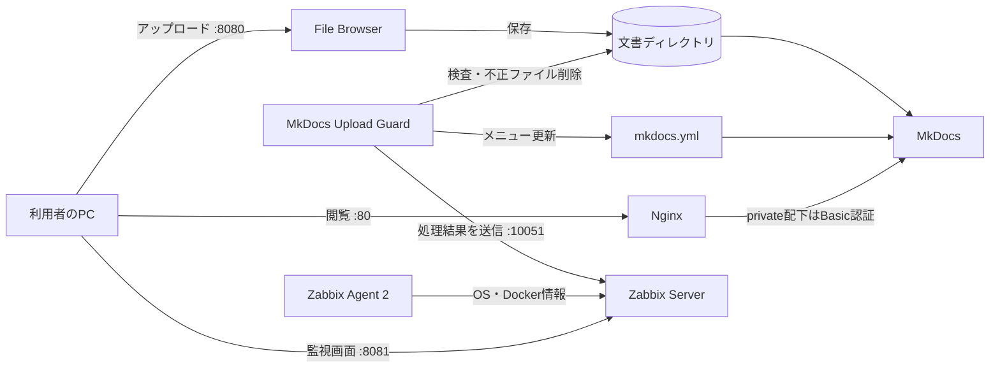

# レポート追記文案

レビューで指摘した不足箇所について、レポートにそのまま貼り付けられる文章をまとめた。図番号は、構成図とソースコードを図に加えたうえで通し番号に振り直したものである。各節の冒頭の「挿入位置」に従って差し替え・追加すること。

---

## 1. 題目（差し替え）

> 挿入位置：表紙の題目

MkDocsを用いたMarkdown文書公開基盤のオンプレミス構築と監視

---

## 2. はじめに（全文差し替え）

> 挿入位置：「はじめに」の本文全体

近年、生成AIの普及に伴い、AIへの指示や設計資料をMarkdown形式で記述する機会が増えている。Markdownは、書きやすく読みやすいプレーンテキストとして記述した文書を、妥当なHTML文書へ変換できる形式として開発された記法である[1][2]。テキストのままでも読めるが、見出しや表、リンクを多く含む文書は、HTMLに変換してWebブラウザで閲覧するほうが内容を把握しやすい。

一方、Markdownファイルを共有する場面では、ファイルをどこに置き、誰に見せるかが問題となる。外部のクラウドサービスを使えば手軽に公開できるが、授業資料や実験記録の中には、学外に出したくない情報や、一部の利用者にだけ見せたい情報も含まれる。そこで本実験では、学内のPC上に自前のサーバー環境（オンプレミスクラウド）を構築し、Markdown文書の公開から管理までを学内で完結させることにした。

あわせて、サーバーは継続して動き続ける必要がある。構築して終わりにせず、サービスの停止や異常を検知できる状態にすることも、運用を考えるうえで欠かせない。

以上を踏まえ、本実験の目的を次の4点とする。第一に、Webブラウザからアップロードしたファイルを、静的サイトジェネレーターのMkDocsによってHTMLとして閲覧できるようにすることである。第二に、特定のディレクトリ（private）配下の文書に認証による閲覧制限をかけることである。第三に、アップロードされたファイルのうち、Markdownなどの許可したテキストファイル以外を自動で取り除き、サイトのメニュー（ナビゲーション）を自動で更新することである。第四に、構築したサービスの稼働状況をZabbixで監視し、障害を検知できるようにすることである。

---

## 3. 使用ソフトウェアとシステム構成（全文差し替え）

> 挿入位置：「使用ソフトウェア」の章全体

本実験では、ホストOSにUbuntu 20.04.6 LTSを用い、その上でDockerを利用して各サービスをコンテナとして動かした。Dockerは、アプリケーションを「コンテナ」という独立した実行環境に閉じ込めて動かすソフトウェアである。サービスごとに環境を分けられるため、互いの設定が干渉しにくく、作り直しも容易である。

ファイルの受け付けには、File Browserを用いた。File Browserは、Webブラウザからサーバー上のファイルをアップロード・編集・削除できる管理ツールである。HTMLへの変換と表示には、MkDocs（Material for MkDocsのコンテナイメージ）を用いた。MkDocsは、Markdownファイルの集まりからWebサイトを生成する静的サイトジェネレーターである。閲覧制限には、Webサーバー兼リバースプロキシであるNginxを用いた。利用者からの要求をいったんNginxが受け、private配下への要求にだけBasic認証をかけてからMkDocsへ中継する。

アップロードされたファイルの検査とナビゲーションの自動更新には、Python 3で自作したMkDocs Upload Guardを用いた。Upload Guardは、文書ディレクトリを定期的に調べ、許可していないファイルを削除するとともに、Markdownファイルの階層からMkDocsの設定ファイル（mkdocs.yml）のメニューを書き換える。監視には、統合監視ソフトウェアのZabbix 7.4を用いた。Zabbix Server、Web画面、データベースをコンテナとして動かし、ホスト上のZabbix Agent 2がOSとDockerの情報を収集する。

これらの関係を図1に示す。利用者はFile Browser（8080番ポート）でファイルをアップロードし、Nginx（80番ポート）経由でMkDocsのページを閲覧する。Upload Guardは文書ディレクトリとmkdocs.ymlを管理し、処理結果をZabbixへ送信する。

> 【図1の作り方】以下のMermaid記法を、VS CodeのMarkdownプレビューや mermaid.live などで描画し、PNGで保存して貼り付ける。



キャプション（図の下）：

図1 システム構成（矢印はデータの流れ、数字は使用するポート番号を示す）

---

## 4. 構築手順の章への追記

### 4.1 章の冒頭に入れる文

> 挿入位置：「構築手順」の見出しの直後（「本システム構築にあたっては…」の後）

本章では、事前に作成した構築手順書の内容を示す。実機での作業では、ユーザー名やPythonのバージョンの違いなどにより、手順書と異なる操作を行った箇所がある。それらの差異と対処は「構築結果」の章で述べる。

### 4.2 File Browserの説明（差し替え）

> 挿入位置：「File Browser の構築」の2段落目（「コンテナを root で動かすと…」）

手順書では、コンテナが作成するファイルの所有者を一般ユーザーにそろえるため、--userオプションで一般ユーザーのUID/GIDを指定して起動することとした。コンテナをrootで動かすと、作成されるファイルの所有者がrootになり、一般ユーザーで動作するUpload Guardから削除や管理ができなくなるためである。なお、実機ではこのオプションを付けずに起動した（「構築結果」の章を参照）。

### 4.3 Docker の手順中のユーザー名

> 挿入位置：Dockerのインストール手順のコードの直後

手順書ではユーザー名をaketimaikaとしていたが、実機の作業ユーザーはeece-15-d04であった。

### 4.4 「確認：」の書き方（差し替え）

> 挿入位置：Nginxの手順の「確認：」と、その下の表の間

閲覧制限の確認項目を表1に示す。このうち公開ページの表示は図6で確認した。制限ページの認証は、本報告の時点では未確認である。

表のキャプション（表の上）：

表1 Nginxによる閲覧制限の確認項目

### 4.5 ソースコード図のキャプション

> 挿入位置：各コードブロックの直下

主要な設定ファイルを図として扱い、次のキャプションを付ける。コードブロック先頭の「None」は削除する。

`nginx.conf` の下：

図2 Nginxの設定ファイル（nginx.conf）。/private/ 配下にのみBasic認証をかけ、すべての要求をMkDocsコンテナの8000番へ中継する

systemdユニットファイルの下：

図3 Upload Guardを常駐させるsystemdユーザーサービスの定義（mkdocs-upload-guard.service）

その他のコマンド列は、図番号を付けずに本文中の「コマンド例」として扱ってよい。番号を付ける場合は、図3と図4の間に通し番号で追加する。

---

## 5. 構築結果の図と説明（差し替え）

> 挿入位置：「構築結果概要」の図1〜図4とその説明文。画像は必要な部分だけに切り抜き、PNGで貼り直す。

### 5.1 図4（ターミナル画面）

Tera Termの部分だけに切り抜く。可能なら、画像の代わりに次のテキストを1×1の表に貼る（ログの該当箇所を抜粋したもの）。

```text
$ sudo -u zabbix zabbix_agent2 -c /etc/zabbix/zabbix_agent2.conf -t docker.ping
docker.ping                                   [s|1]

$ docker ps --format 'table {{.Names}}\t{{.Image}}\t{{.Ports}}'
NAMES                                    IMAGE                                             PORTS
zabbix-docker-zabbix-server-1            zabbix/zabbix-server-mysql:alpine-7.4-latest      0.0.0.0:10051->10051/tcp
zabbix-docker-zabbix-web-nginx-mysql-1   zabbix/zabbix-web-nginx-mysql:alpine-7.4-latest   0.0.0.0:8081->8080/tcp, 0.0.0.0:443->8443/tcp
zabbix-docker-mysql-server-1             mysql:8.4-oracle
school-nginx                             nginx:alpine                                      0.0.0.0:80->80/tcp
mkdocs                                   squidfunk/mkdocs-material                         8000/tcp, 0.0.0.0:8000->80/tcp
filebrowser                              filebrowser/filebrowser                           0.0.0.0:8080->80/tcp
```

説明文：

最終的に11時28分の時点では、文書公開系のFile Browser、MkDocs、Nginxの3コンテナと、監視系のZabbix Server、Zabbix Web、MySQLの3コンテナの計6コンテナが稼働していた。その時点のコマンド実行結果を図4に示す。図4の1つ目のコマンドの結果を見ると、Zabbix Agent 2によるDockerの死活確認（docker.ping）の値が1となっており、AgentがDockerと正常に通信できていることがわかる。2つ目のdocker psの結果には6つのコンテナ名が並んでおり、それぞれのPORTS欄から、File Browserが8080番、Nginxが80番、Zabbix Webが8081番、Zabbix Serverが10051番で公開されていることが確認できる。

キャプション：

図4 Zabbix AgentによるDockerの死活確認と、稼働中のコンテナ一覧（Tera Termのログから抜粋）

### 5.2 図5（File Browser）

画面左のメニューとファイル一覧の部分を切り抜き、ファイル一覧に赤枠を付ける。

説明文：

図5は、File Browser（8080番ポート）にadminでログインした画面である。図5の赤枠で示したファイル一覧には、閲覧制限用のprivateフォルダー、MkDocsが生成したindex.md、ブラウザからアップロードしたCisco コマンド.mdと夏研修 WiFi.mdの4項目が表示されている。File Browserの保存先はMkDocsの文書ディレクトリに設定しているため、ブラウザからのアップロードによって、MkDocsが参照するディレクトリへファイルを配置できたことになる。

キャプション：

図5 File Browserのファイル一覧（赤枠：アップロードしたMarkdownファイルとprivateフォルダー）

### 5.3 図6（MkDocsのページ）

左のナビゲーション（赤枠A）、本文（赤枠B）、アドレスバー（赤枠C）に赤枠を付ける。

説明文：

図6は、Nginx（80番ポート）経由で、アップロードした夏研修 WiFi.mdを閲覧した画面である。赤枠Cのアドレスバーにはポート番号の指定がなく、80番のNginxを経由して表示していることがわかる。また、認証画面を経ずに表示されたことから、公開ページは認証なしで閲覧できることを確認した。赤枠Bの本文では、Markdownで記述した見出しと箇条書きが、HTMLの見出しとリストに変換されて表示されている。赤枠Aのナビゲーションには、アップロードした2つのファイルが自動で追加されている。mkdocs.ymlは手作業で編集していないため、Upload Guardがファイルの追加を検知してメニューを更新したと判断できる。

キャプション：

図6 Nginx経由で表示したMkDocsのページ（A：自動更新されたナビゲーション、B：HTMLに変換された本文、C：アドレスバー）

### 5.4 図7（Zabbixダッシュボード）

「システム情報」（赤枠A）、「ホスト稼働状況」（赤枠B）、「Current problems」（赤枠C）の3か所を切り抜くか、赤枠を付ける。文字が読める大きさになっていることを、出力したPDFで確認する。

説明文：

図7は、Zabbix Web（8081番ポート）のダッシュボードである。赤枠Aのシステム情報では、「Zabbixサーバーの起動」が「はい」と表示されている。また、サーバーとWebインターフェースのバージョンがいずれも7.4.15であることから、監視基盤が動作していることを確認した。一方、赤枠Bのホスト稼働状況では、登録ホストは1台で、その状態は「不明」であった。赤枠Cの障害一覧には、既定のホスト「Zabbix server」について「Linux: Active checks are not available」が重度の障害として表示されている。

キャプション：

図7 Zabbix Webのダッシュボード（A：システム情報、B：ホスト稼働状況、C：障害一覧）

### 5.5 発生した問題の証拠（追加）

> 挿入位置：「発生した問題と対処」の3件目と5件目の説明の直後

3件目の直後に追加する文：

このときのエラー出力を図8に示す。最終行に「'type' object is not subscriptable」とあり、428行目の型の別名の定義で、組み込み型のtupleに添字を付けたことが原因であるとわかる。

```text
$ python3 upload_guard.py --config config.json --check-config
Traceback (most recent call last):
  File "upload_guard.py", line 428, in <module>
    NavEntry = tuple[str, str | list["NavEntry"]]
TypeError: 'type' object is not subscriptable
```

キャプション：

図8 Python 3.8でUpload Guardを実行したときのエラー出力（Tera Termのログから抜粋）

5件目の直後に追加する文：

このときのAgentのログを図9に示す。「Server」の設定値「127.0.0.1:10050」が不正なアドレスとして拒否されており、ポート番号を付けたことが原因であるとわかる。

```text
zabbix_agent2[55582]: ERROR: Cannot validate configuration: failed to validate "Server"
configuration parameter: invalid "Server" configuration: incorrect address parameter:
"127.0.0.1:10050".
```

キャプション：

図9 Zabbix Agent 2の起動失敗時のログ（journalctlの出力から抜粋）

### 5.6 結果の章から考察の章へ移す文

結果の章には事実だけを残す。次の文は削除し、内容は7章の考察で扱う。

- 図7の説明にあった「原因と考えられる」「解消する見込みである」を含む文
- 「手順書との差異」にあった「失敗するおそれがある」「削除するのが望ましい」を含む文

---

## 6. 考察（新規）

> 挿入位置：「構築結果」の章の後に、新しい章として追加する

### 6.1 監視が完了しなかった原因

図7で「Linux: Active checks are not available」の障害が発生していたのは、Zabbix Server側とAgent側で、監視対象のホスト名が一致していなかったためと考える。Agent 2は設定ファイルでホスト名をschool-labとしており、この名前でZabbix Serverへ監視項目の問い合わせを行う。しかし、図7の時点でZabbix上に登録されていたのは既定のホスト「Zabbix server」だけであった。そのため、school-labからの問い合わせに対応するホストが存在せず、既定ホストにはどのAgentからも通信が届かない状態になっていたと考えられる。Zabbix上にschool-labという名前のホストを作成し、Linux監視とDocker監視のテンプレートを割り当てれば、この障害は解消し、OSとコンテナの監視が始まると予想する。今回は時間内にこの設定まで到達できなかった。監視基盤の構築とホストの登録を分けて計画し、ホスト登録までを1回の作業時間内に終える段取りが必要であった。

### 6.2 閲覧制限の確実性

閲覧制限は、URLのパスに対して認証をかける方式である。そのため、private配下の文書の内容が別の経路から取得できると、制限の意味がなくなる。本構成では、MkDocsの検索機能を無効にした。検索機能は全ページの本文を一つのファイルにまとめて公開するため、制限ページの本文が認証なしで読めてしまうからである。また、図4のdocker psの結果では、MkDocsのコンテナは8000番で待ち受けているが、ホストの8000番はコンテナの80番に転送されていた。このため、ホストの8000番から直接MkDocsへ到達することはできず、結果的に閲覧はNginx経由に限られていた。ただし、これは意図した設定ではない。仮にポートの対応を「正しく」直すと、Nginxを経由せずに制限ページを閲覧できてしまう。MkDocsのコンテナはポートを公開せず、Nginxと同じDockerネットワークの中からのみ到達できるようにするのが適切であると考える。

さらに、Basic認証はIDとパスワードを暗号化せずに送信する。そのため、HTTPのままでは通信経路上で盗み見られる危険がある。当初はより高機能な認証基盤であるAutheliaの導入を検討したが、HTTPSが必須であり、証明書を用意できなかったため断念した。学内の閉じたネットワークに限れば今回の方式でも一定の効果はあるが、実際に運用するには、HTTPS化とあわせて認証方式を見直す必要がある。

### 6.3 実機環境との差異

構築中に発生した問題の多くは、手順書が想定した環境と実機との差異に起因していた。Upload Guardのエラー（図8）は、新しいPythonの記法を前提に作成したプログラムを、Ubuntu 20.04標準のPython 3.8で実行したために起きた。Agentの起動失敗（図9）は、似た名前の設定項目でも、ポート番号を書けるものと書けないものがあることを見落としたために起きた。File Browserのコンテナ名の重複は、rootに切り替えるとホームディレクトリの場所が変わることを意識していなかったために起きた。これらの経験から、手順書を作る段階で実機のOSやソフトウェアのバージョンを確認しておくこと、設定を変更したら再起動の前に検証コマンドで確かめることが、トラブルを減らすうえで有効であると考える。

また、File Browserの起動時には、開発プロジェクトが2026年9月1日に終了し、今後はセキュリティ修正が提供されない旨の通知が表示された。今回のように学内で一時的に使う分には問題は小さいが、継続して運用する場合は、保守が続いている別のソフトウェアへの置き換えを検討すべきである。

---

## 7. 結論（新規）

> 挿入位置：「考察」の章の後に、新しい章として追加する

本実験では、学内のPC上にDockerを用いてFile Browser、MkDocs、Nginx、Zabbixを構築し、自作のUpload Guardと組み合わせて、Markdown文書を公開・管理・監視する基盤の構築を目指した。はじめにで挙げた4つの目的について、達成状況を述べる。

第一の目的である、アップロードしたMarkdownファイルをHTMLとして閲覧できるようにすることは、達成できた。File Browserからアップロードしたファイルが文書ディレクトリに保存され（図5）、Nginx経由でHTMLのページとして表示されることを確認した（図6）。

第二の目的である、private配下への閲覧制限は、Nginxの設定と認証ユーザーの作成までは完了した。しかし、実際に認証画面が表示されるかどうかは確認できておらず、達成したとは言えない。

第三の目的である、不正なファイルの自動削除とナビゲーションの自動更新は、一部を達成した。Upload Guardを常駐させ、アップロードしたファイルがナビゲーションに自動で追加されることは確認できた（図6）。一方、許可していないファイルを実際にアップロードして削除されるかどうかの試験は行っていない。

第四の目的である、サービスの稼働監視は達成できなかった。Zabbixの監視基盤とAgent 2は起動し、AgentがDockerの情報を取得できることも確認した（図4、図7）。しかし、Zabbix上に監視対象ホストを登録していなかったため、実際の監視と障害検知には至らなかった（6.1節）。

以上より、本実験の中心であるMarkdown文書のHTML公開は実現できたが、閲覧制限の確認と稼働監視は未完了である。今後は、Zabbixへの監視対象ホストの登録、閲覧制限と自動削除の動作試験、MkDocsのポート公開の削除、HTTPS化に取り組む。

---

## 8. 参考文献（新規）

> 挿入位置：「班員からのコメント」の前。閲覧日は実際に確認した日付に直すこと。

[1] J. Gruber, "Markdown," Daring Fireball, https://daringfireball.net/projects/markdown/ （2026年10月10日閲覧）

[2] Wikipedia, 「Markdown」, https://ja.wikipedia.org/wiki/Markdown （2026年10月10日閲覧）

[3] Docker Inc., "Install Docker Engine on Ubuntu," https://docs.docker.com/engine/install/ubuntu/ （2026年10月10日閲覧）

[4] MkDocs, https://www.mkdocs.org/ （2026年10月10日閲覧）

[5] M. Donath, "Material for MkDocs," https://squidfunk.github.io/mkdocs-material/ （2026年10月10日閲覧）

[6] File Browser, https://filebrowser.org/ （2026年10月10日閲覧）

[7] Zabbix SIA, 「コンテナからのインストール」, Zabbix 7.4 マニュアル, https://www.zabbix.com/documentation/7.4/jp/manual/installation/containers （2026年10月10日閲覧）

[8] 構築手順書およびMkDocs Upload Guard, https://github.com/Aketi-Maika/Aketi-School-LAB （2026年10月10日閲覧）

---

## 9. 文章では補えない残りの作業

- 表紙の学生番号（25A5nnn）を記入する。
- 「班員からのコメント」を班員に書いてもらう。
- 図4〜7をPNGで撮り直す（または変換する）。必要な部分だけに切り抜いて赤枠を付け、出力したPDFで文字が読めることを確認する。
- 「4.6」「5.4」など残っている節番号を、すべての見出しで付けるか、すべて外すかに統一する。本文中の「4.8節」「5.3節」「6章」の参照も合わせて直す。
- 「構築結果」の章でリンクしているTera Termログから、File Browserの初期パスワードの行を伏せる。
