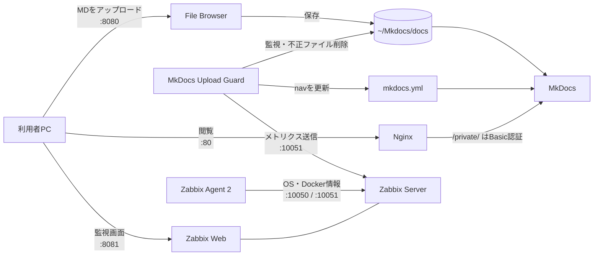
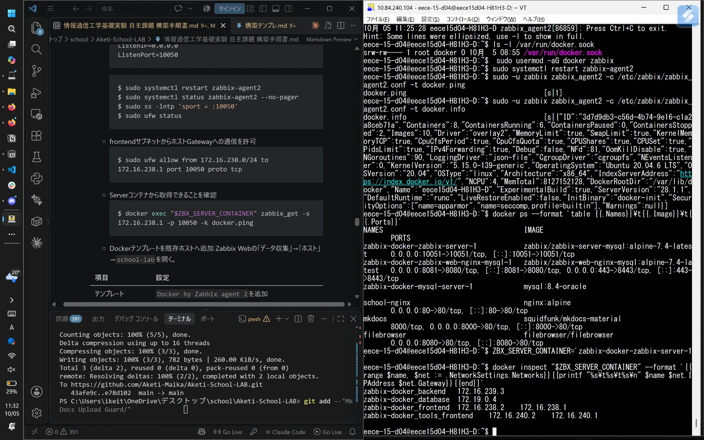
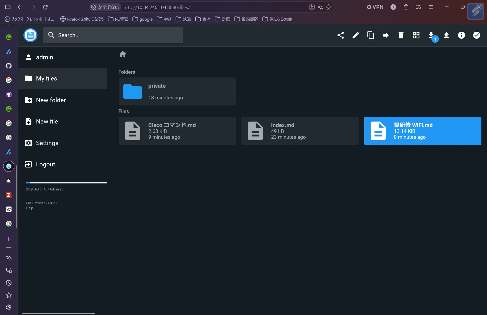
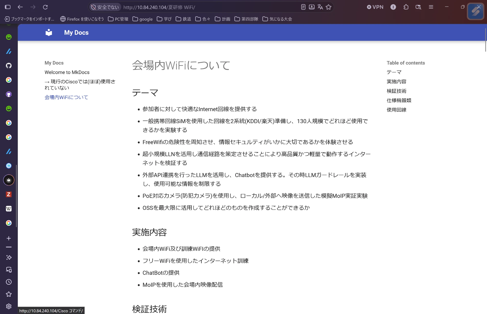
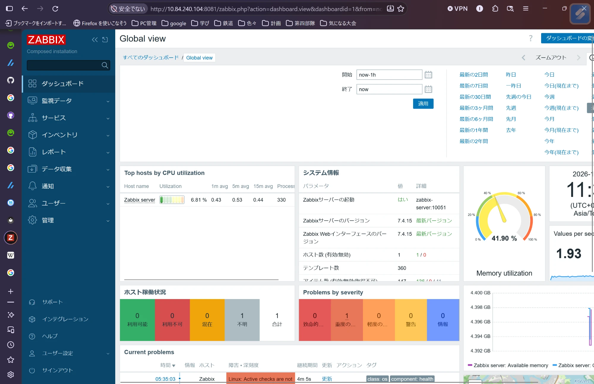

# 情報通信工学基礎実験 自主課題 報告書
## オンプレミス環境におけるMarkdown文書公開基盤の構築と監視

- 構築作業日：2026年10月5日
- 氏名：【記入】
- 学籍番号：【記入】

---

## 1. 目的

本課題では、学校のPC上にオンプレミスのクラウド環境を構築し、以下の3点を実現することを目的とする。

1. Webブラウザからアップロードした Markdown（MD）ファイルを、HTMLとして閲覧できるようにする。
2. 特定のディレクトリ（`private/`）配下の文書に閲覧制限をかける。
3. 構築したサービスの稼働状況を監視し、障害を検知できるようにする。

## 2. 背景

授業課題として、複数のOSS（オープンソースソフトウェア）を組み合わせて実用的なサービスを構築することが求められた。
文書をMarkdownで記述・共有する運用は一般的であるが、そのままでは閲覧性が低く、また公開範囲の制御も難しい。
そこで、ファイル管理・HTML変換・アクセス制御・監視をそれぞれ別のコンテナとして構築し、それらを連携させることで一つの文書公開基盤を構成した。

## 3. 実験環境

### 3.1 構築対象機器

| 項目 | 内容 |
|---|---|
| 機器 | 学校のPC（ホスト名 `eece15d04-H81H3-D`、IP `10.84.240.104/24`） |
| OS | Ubuntu 20.04.6 LTS（カーネル 5.15.0-139-generic） |
| 実行ユーザー | `eece-15-d04`（一般ユーザー、`docker`グループ所属） |
| 操作方法 | Tera Term による SSH 接続（操作ログを取得） |

### 3.2 使用ソフトウェア

| ソフトウェア | 動作形態 | 役割 |
|---|---|---|
| Docker Engine / Docker Compose | ホスト | コンテナ実行基盤 |
| File Browser | コンテナ | Webブラウザからのファイルアップロード・管理 |
| MkDocs（Material for MkDocs） | コンテナ | MarkdownをHTMLへ変換して表示 |
| Nginx | コンテナ | リバースプロキシ・Basic認証による閲覧制限 |
| Zabbix 7.4（Server / Web / DB） | コンテナ | 監視サーバー |
| Zabbix Agent 2 | ホスト | OS・Dockerの監視データ収集 |
| MkDocs Upload Guard（自作） | ホスト（Python 3、systemdユーザーサービス） | アップロードファイルの検査、ナビゲーション自動生成、Zabbixへのメトリクス送信 |

なお、当初はアクセス管理に Authelia の採用を検討したが、Authelia は HTTPS での運用が必須であり、本環境では証明書の用意が困難であったため断念した。代替として Nginx の Basic 認証を採用した。

### 3.3 システム構成



### 3.4 使用ポート一覧

| ポート | サービス | 用途 |
|---|---|---|
| 80 | Nginx | 文書閲覧（公開ページ・制限ページ） |
| 8080 | File Browser | ファイルのアップロード・管理 |
| 8081 | Zabbix Web | 監視画面 |
| 443 | Zabbix Web | 監視画面（HTTPS。公式 Compose の既定で公開される） |
| 10050 | Zabbix Agent 2 | Zabbix Server からのパッシブ監視 |
| 10051 | Zabbix Server | アクティブ監視・trapper（Upload Guard からの送信） |

## 4. 構築手順

### 4.1 Docker のインストール

Docker 公式リポジトリを登録し、Docker Engine と Compose プラグインをインストールした。

```bash
sudo su -
apt update && apt upgrade -y
apt install -y ca-certificates curl gnupg

# GPGキーの登録
install -m 0755 -d /etc/apt/keyrings
curl -fsSL https://download.docker.com/linux/ubuntu/gpg | gpg --dearmor -o /etc/apt/keyrings/docker.gpg
chmod a+r /etc/apt/keyrings/docker.gpg

# リポジトリの登録（未対応のリリースの場合は直前のLTS(noble)で代用）
CODENAME=$(. /etc/os-release && echo "$VERSION_CODENAME")
curl -fsI "https://download.docker.com/linux/ubuntu/dists/${CODENAME}/Release" || CODENAME=noble
echo "deb [arch=$(dpkg --print-architecture) signed-by=/etc/apt/keyrings/docker.gpg] https://download.docker.com/linux/ubuntu ${CODENAME} stable" \
  > /etc/apt/sources.list.d/docker.list

# インストール
apt update
apt install -y docker-ce docker-ce-cli containerd.io docker-buildx-plugin docker-compose-plugin

# 一般ユーザーを docker グループへ追加し、自動起動を設定
usermod -aG docker eece-15-d04
systemctl enable docker.service containerd.service
exit
```

**確認**：`docker --version`、`docker compose version` でバージョンが表示され、`docker run --rm hello-world` が正常に終了することを確認した。その後、再ログインして `docker` グループの設定を反映した。

### 4.2 Python 3 の確認

Upload Guard の実行に Python 3 を使用する。`python3 --version` でインストール済みであることを確認した（未インストールの場合は `sudo apt install python3` で導入する）。

### 4.3 File Browser の構築

Web ブラウザからファイルをアップロードするため File Browser を構築した。
アップロード先は MkDocs の文書ディレクトリ（`~/Mkdocs/docs`）とし、アップロードしたファイルがそのまま MkDocs に反映されるようにした。

コンテナを root で動かすと、作成されるファイルの所有者が root になり、一般ユーザーで動作する Upload Guard から削除・管理できなくなる。そのため `--user` オプションで一般ユーザーの UID/GID を指定して起動した。

```bash
mkdir -p "$HOME/filebrowser/database" "$HOME/filebrowser/config" "$HOME/Mkdocs/docs"

docker run -d \
  --name filebrowser \
  --restart unless-stopped \
  --user "$(id -u):$(id -g)" \
  -v "$HOME/Mkdocs/docs:/srv" \
  -v "$HOME/filebrowser/database:/database" \
  -v "$HOME/filebrowser/config:/config" \
  -p 8080:80 \
  filebrowser/filebrowser
```

**確認**：`docker logs filebrowser` で admin の初期パスワードを確認した（初回起動時のみ表示されるため必ず控える）。`http://localhost:8080` に admin でログインできることを確認した。

### 4.4 MkDocs の構築

Material for MkDocs の公式イメージを用いて、プロジェクトを作成した。

```bash
docker pull squidfunk/mkdocs-material
mkdir -p "$HOME/Mkdocs"
docker run --rm -it --user "$(id -u):$(id -g)" -v "$HOME/Mkdocs:/docs" squidfunk/mkdocs-material new .
mkdir -p "$HOME/Mkdocs/docs/private"
```

`mkdocs.yml` に以下を設定した。

```yaml
plugins: []
```

これは検索プラグインを無効化する設定である。検索プラグインが有効な場合、全ページの本文が検索インデックス（`/search/search_index.json`）に出力されるため、`/private/` に認証をかけても制限ページの本文が認証なしで読めてしまう。これを防ぐために無効化した。

続いて、Nginx と名前で通信するための Docker ネットワークを作成し、MkDocs を起動した。

```bash
docker network create school-lab
docker run -d \
  --name mkdocs \
  --restart unless-stopped \
  --network school-lab \
  -v "$HOME/Mkdocs:/docs" \
  -p 8000:80 \
  squidfunk/mkdocs-material
```

### 4.5 Nginx による閲覧制限

MkDocs の前段に Nginx をリバースプロキシとして配置し、`/private/` 配下へのアクセスにのみ Basic 認証をかけた。

`~/nginx/nginx.conf`：

```nginx
events {}
http {
  server {
    listen 80;
    location /private/ {
      auth_basic "Restricted";
      auth_basic_user_file /etc/nginx/.htpasswd;
      proxy_pass http://mkdocs:8000;
    }
    location / {
      proxy_pass http://mkdocs:8000;
    }
  }
}
```

認証ユーザー `student` を作成し、Nginx を起動した。

```bash
docker run --rm -it -v "$HOME/nginx:/work" httpd:2.4-alpine htpasswd -c /work/.htpasswd student

docker run -d \
  --name school-nginx \
  --restart unless-stopped \
  --network school-lab \
  -p 80:80 \
  -v "$HOME/nginx/nginx.conf:/etc/nginx/nginx.conf:ro" \
  -v "$HOME/nginx/.htpasswd:/etc/nginx/.htpasswd:ro" \
  nginx:alpine
```

**確認**：

| URL | 期待する動作 |
|---|---|
| `http://<サーバーIP>/` | 認証なしで公開ページが表示される |
| `http://<サーバーIP>/private/` | 認証画面が表示され、`student` でログイン後に表示される |

### 4.6 MkDocs Upload Guard の導入

File Browser からは任意のファイルをアップロードできるため、以下の機能を持つ Python スクリプト「MkDocs Upload Guard」を作成し、常駐させた（外部パッケージ不要）。

- 許可した拡張子（`.md`、`.markdown`、`.txt`）かつ UTF-8 テキストのファイルのみを保持し、バイナリや未許可拡張子のファイル、シンボリックリンクを自動削除する。
- アップロード途中のファイルを誤って削除しないよう、サイズと更新日時が一定時間（`settle_seconds`）変化しなくなってから検査する。
- Markdown のディレクトリ階層から `mkdocs.yml` の `nav`（サイドメニュー）を自動生成する。
- 処理件数やハートビートを Zabbix sender プロトコルで Zabbix へ送信する。

**取得と設定**

```bash
(
set -eu
DEST="$HOME/mkdocs-upload-guard"
TEMP_DIR="$(mktemp -d)"
git clone --depth 1 "https://github.com/Aketi-Maika/Aketi-School-LAB.git" "$TEMP_DIR/repository"
install -d -m 0750 "$DEST"
cp -a "$TEMP_DIR/repository/MkDocs Upload Guard/." "$DEST/"
rm -rf -- "$TEMP_DIR"
)

cd "$HOME/mkdocs-upload-guard"
cp -n config.example.json config.json
chmod 600 config.json
chmod 750 upload_guard.py
```

`config.json` の主な設定値：

```json
"watch_dir": "~/Mkdocs/docs",
"mkdocs_config": "~/Mkdocs/mkdocs.yml",
"log_file": "~/mkdocs-upload-guard/upload_guard.log",
```

**検証と初回実行**

```bash
python3 -m json.tool config.json > /dev/null
python3 upload_guard.py --config config.json --check-config
python3 upload_guard.py --config config.json --once
```

**常駐化**：ログアウト後も動作し続けるよう、systemd のユーザーサービスとして登録し、`loginctl enable-linger` でユーザーセッション外でも起動するようにした。

`~/.config/systemd/user/mkdocs-upload-guard.service`：

```ini
[Unit]
Description=MkDocs Upload Guard

[Service]
Type=simple
WorkingDirectory=%h/mkdocs-upload-guard
ExecStart=/usr/bin/python3 %h/mkdocs-upload-guard/upload_guard.py --config %h/mkdocs-upload-guard/config.json
Restart=on-failure
RestartSec=5

[Install]
WantedBy=default.target
```

```bash
systemctl --user daemon-reload
systemctl --user enable --now mkdocs-upload-guard.service
sudo loginctl enable-linger "$USER"
systemctl --user status mkdocs-upload-guard.service
```

### 4.7 Zabbix の導入

公式の `zabbix-docker` リポジトリを用い、Zabbix 7.4 を Docker Compose で構築した。Web 画面のポートは Nginx（80）、File Browser（8080）と重複しないよう 8081 とした。

```bash
git clone https://github.com/zabbix/zabbix-docker.git
cd zabbix-docker
git checkout 7.4
ZABBIX_WEB_NGINX_HTTP_PORT=8081 docker compose -f ./compose.yaml up -d
```

**確認**：`http://<サーバーIP>:8081` に初期アカウント（`Admin` / `zabbix`）でログインできることを確認した。

### 4.8 Zabbix による監視の構築

#### (1) Upload Guard からのメトリクス受信

Zabbix 上にホスト `school-lab` を作成し、以下の Zabbix trapper アイテムを登録した。共通設定は「タイプ：Zabbix trapper」「データ型：数値（整数・符号なし）」とし、受信値をそのまま保存するため前処理は設定していない。

| キー | 意味 | 単位 |
|---|---|---|
| `mkdocs.upload.accepted_total` | 起動後に受付・再検査した回数 | ― |
| `mkdocs.upload.deleted_total` | 起動後に自動削除した回数 | ― |
| `mkdocs.upload.errors_total` | 起動後の検査・削除・nav更新等のエラー回数 | ― |
| `mkdocs.upload.nav_updates_total` | 起動後の nav 更新回数 | ― |
| `mkdocs.upload.files_current` | 現在のファイル数 | ― |
| `mkdocs.upload.last_event_unixtime` | 最後のファイルイベント時刻 | unixtime |
| `mkdocs.upload.heartbeat` | ハートビートの送信時刻 | unixtime |

Upload Guard の `config.json` で Zabbix 送信を有効にし、サービスを再起動した。

```json
"heartbeat_seconds": 60,
"zabbix": {
  "enabled": true,
  "server": "127.0.0.1",
  "port": 10051,
  "host": "school-lab",
  "timeout_seconds": 5,
  "key_prefix": "mkdocs.upload"
}
```

```bash
systemctl --user restart mkdocs-upload-guard.service
journalctl --user -u mkdocs-upload-guard.service -n 50 --no-pager
```

#### (2) Zabbix Agent 2 によるOS監視

ホストに Zabbix Agent 2 をインストールした。

```bash
UBUNTU_VERSION=$(. /etc/os-release && printf '%s' "$VERSION_ID")
AGENT_SETUP_DIR=$(mktemp -d)
curl -fL \
  "https://repo.zabbix.com/zabbix/7.4/release/ubuntu/pool/main/z/zabbix-release/zabbix-release_7.4-3+ubuntu${UBUNTU_VERSION}_all.deb" \
  -o "$AGENT_SETUP_DIR/zabbix-release.deb" &&
  sudo dpkg -i "$AGENT_SETUP_DIR/zabbix-release.deb" &&
  sudo apt update &&
  sudo apt install -y zabbix-agent2
```

Zabbix Web の「データ収集」→「ホスト」→`school-lab` にテンプレート `Linux by Zabbix agent active` を追加し、既存の trapper アイテムは残したまま更新した。数分後、「監視データ」→「最新データ」で CPU・メモリ・ディスクの値が取得できていることを確認した。

#### (3) Docker の監視

Agent 2 が Docker の情報を取得できるよう、`zabbix` ユーザーを `docker` グループに追加した。

```bash
sudo usermod -aG docker zabbix
sudo systemctl restart zabbix-agent2
sudo -u zabbix zabbix_agent2 -c /etc/zabbix/zabbix_agent2.conf -t docker.ping
```

`Docker by Zabbix agent 2` テンプレートはパッシブ監視（Server → Agent）で動作するため、Zabbix Server コンテナからホスト上の Agent へ接続できる必要がある。
`docker inspect` / `docker network inspect` で Zabbix Server コンテナが属する frontend ネットワークのサブネットとゲートウェイを調べ（本環境では `172.16.238.0/24`、ゲートウェイ `172.16.238.1`）、Agent の設定とファイアウォールに反映した。

`/etc/zabbix/zabbix_agent2.conf`（最終的な設定）：

```ini
Server=127.0.0.1,172.16.238.0/24
ServerActive=127.0.0.1:10051
Hostname=school-lab
ListenIP=0.0.0.0
ListenPort=10050
```

```bash
sudo systemctl enable zabbix-agent2
sudo systemctl restart zabbix-agent2

# ufw が有効な場合のみ、frontend サブネットからの接続を許可する
# （本環境では `ufw status` が「非アクティブ」であったため不要）
sudo ufw allow from 172.16.238.0/24 to 172.16.238.1 port 10050 proto tcp

# Server コンテナから Agent へ到達できることを確認
docker exec "$ZBX_SERVER_CONTAINER" zabbix_get -s 172.16.238.1 -p 10050 -k docker.ping
```

`school-lab` ホストに以下を設定した。

| 項目 | 設定 |
|---|---|
| テンプレート | `Linux by Zabbix agent active` に加え `Docker by Zabbix agent 2` を追加 |
| Agent インターフェース | IP：`172.16.238.1`、ポート：`10050` |
| 監視元 | Server |

さらに、File Browser コンテナの停止を検知するトリガーを作成した。

| 名前 | 深刻度 | 条件式 |
|---|---|---|
| 【記入】 | 【記入】 | 【記入】 |

#### (4) Upload Guard のプロセス監視・処理監視

Upload Guard のプロセス数を監視するアイテムを作成した。

| 項目 | 設定 |
|---|---|
| 名前 | `MkDocs Upload Guard: プロセス数` |
| タイプ | Zabbix エージェント（アクティブ） |
| キー | `proc.num[python3,,,"upload_guard[.]py"]` |
| 更新間隔 | `30s` |

以下のトリガーを作成した。

| 名前 | 深刻度 | 条件式 |
|---|---|---|
| Upload Guard: プロセス停止 | 軽度の障害 | `max(/school-lab/proc.num[python3,,,"upload_guard[.]py"],2m)=0` |
| Upload Guard: 二重起動 | 警告 | `min(/school-lab/proc.num[python3,,,"upload_guard[.]py"],2m)>1` |
| Upload Guard: ハートビート受信途絶 | 軽度の障害 | `nodata(/school-lab/mkdocs.upload.heartbeat,3m)=1` |
| Upload Guard: 処理エラー発生 | 警告 | `changecount(/school-lab/mkdocs.upload.errors_total,5m,"inc")>0` |
| Upload Guard: 未許可ファイルを削除 | 情報 | `changecount(/school-lab/mkdocs.upload.deleted_total,5m,"inc")>0` |

プロセス監視とハートビート監視を併用することで、「プロセスは存在するが内部で停止している」状態も検知できるようにした。

## 5. 構築結果概要

### 5.1 作業の記録と構築環境

構築作業は2026年10月5日の9時45分から11時38分にかけて行った。学校のPC（IPアドレス10.84.240.104）にTera TermからSSHで接続して操作し、その操作ログを2本に分けて保存した。1本目のログ（9時45分〜9時53分）には、Dockerの導入状況とPythonのバージョンの確認、File Browser用ディレクトリの作成、誤って作成したコンテナの削除までが記録されている。2本目のログ（9時54分〜11時38分）には、File BrowserからZabbix Agent 2までの構築作業が記録されている。

ログから確認した構築環境は次のとおりである。OSはUbuntu 20.04.6 LTS（カーネル5.15.0-139-generic）、作業ユーザーはeece-15-d04である。Dockerは28.1.1、Docker Composeはv2.35.1、Pythonは3.8.10であった。監視系では、Zabbix ServerとWebに公式の7.4系Alpineイメージを、データベースにMySQL 8.4を、ホスト側のエージェントにZabbix Agent 2のバージョン7.4.15を用いた。

### 5.2 各構成要素の構築結果

Dockerは、必要なパッケージがすべて導入済みであった。hello-worldコンテナの実行に成功し、DockerとcontainerdのOS起動時の自動起動も有効にした。

File Browserは、一般ユーザーの権限でコンテナとして起動した。ホストのMkdocs/docsディレクトリがコンテナ内の/srvにマウントされていること、初期管理者ユーザーが生成されたこと、ホストの8080番ポートで待ち受けを開始したことをログで確認した。

MkDocsは、公式イメージで新規プロジェクトを作成し、設定ファイルmkdocs.ymlと初期ページindex.mdを生成した。続いて閲覧制限用のprivateディレクトリを作成し、Nginxと通信するための専用Dockerネットワーク上でコンテナを起動した。

Nginxは、Basic認証用のユーザーstudentを作成したうえで、ホストの80番ポートで起動した。

MkDocs Upload Guardは、GitHubから取得して設定ファイルを作成し、設定検証で「configuration is valid」となった。初回の一括検査ではindex.mdが正規のファイルとして受け付けられ、mkdocs.ymlのナビゲーションが自動更新された。その後systemdのユーザーサービスとして登録し、稼働状態（active (running)）になったことを確認した。

Zabbixは、公式のDocker Compose構成で、Server、Web、データベースの各コンテナを起動した。データベースの初期化処理が正常に終了した後に全コンテナが起動し、Serverは10051番、Web画面は8081番と443番で公開された。

Zabbix Agent 2は、Zabbix公式リポジトリから導入した。設定の修正を経て、ホスト名school-labとして稼働状態になった。Agentの実行ユーザーをdockerグループに追加した結果、Dockerの死活確認（docker.ping）で正常値1が返り、Docker全体の情報（コンテナ8個のうち6個が稼働中）も取得できた。さらに、Zabbix ServerコンテナからAgentへ接続できるよう、Serverコンテナが属するネットワークの範囲（172.16.238.0/24）をAgentの接続許可先に追加し、設定検証に成功したことを確認した。

最終的に11時28分の時点では、文書公開系のFile Browser、MkDocs、Nginxの3コンテナと、監視系のZabbix Server、Zabbix Web、MySQLの3コンテナの計6コンテナが稼働していた。ホスト上では、Upload GuardとZabbix Agent 2も稼働していた。この時点のターミナル画面を図1に示す。Agentによるdocker.pingとdocker.infoの取得結果、docker psによる6コンテナの稼働状況、Zabbix Serverコンテナが属する4つのネットワークとそれぞれのIPアドレスが確認できる。



*図1 Zabbix AgentによるDocker情報の取得とコンテナの稼働状況（右側のTera Term画面）*

### 5.3 画面による動作確認

構築後、利用者側のPCのWebブラウザから各サービスにアクセスし、画面上で動作を確認した。

図2は、File Browser（8080番ポート）にadminでログインした画面である。File Browserのバージョンは2.63.23であった。文書ディレクトリには、閲覧制限用のprivateフォルダー、MkDocsが生成したindex.md、利用者がアップロードしたCisco コマンド.mdと夏研修 WiFi.mdが保存されている。このことから、ブラウザからのアップロードによってMkDocsの文書ディレクトリへファイルを配置できることを確認した。



*図2 File Browserの管理画面（アップロードしたMarkdownファイルとprivateフォルダー）*

図3は、Nginx（80番ポート）経由で、アップロードした夏研修 WiFi.mdを閲覧した画面である。Markdownで記述した見出しや箇条書きがHTMLに変換されて表示され、右側には見出しから自動生成された目次も表示されている。左側のナビゲーションには、アップロードした2つのファイルが自動で追加されている。これは、Upload Guardがファイルの追加を検知し、mkdocs.ymlのナビゲーションを更新したことを示している。なお、Cisco コマンド.mdは、ファイル名ではなく「→ 現行のCiscoでは(ほぼ)使用されていない」という名前でナビゲーションに表示された。Upload Guardは各ファイルの最初の見出しを表示名に用いるため、ファイル内で最初に現れた見出しがそのまま採用されたものである。privateフォルダーにはまだMarkdownファイルがないため、ナビゲーションには表示されていない。



*図3 Nginx経由で表示したMkDocsのページ（アップロードした夏研修 WiFi.md）*

図4は、Zabbix Web（8081番ポート）のダッシュボードである。システム情報には、Zabbixサーバーが起動していること（zabbix-server:10051）と、サーバー・Webインターフェースのバージョンがいずれも7.4.15であることが表示されている。テンプレート数は360、アイテム数は147（有効136、取得不可11）であった。一方、ホスト数は1、ホスト稼働状況は「不明」が1であった。障害一覧には、既定のホスト「Zabbix server」について「Linux: Active checks are not available」（重度）が表示されている。Agent 2はホスト名school-labとして動作しているが、この時点ではZabbix上にschool-labホストが登録されておらず、既定ホストに対するアクティブチェックの通信が届いていないことが原因と考えられる。4.8節の手順でschool-labホストを登録し、テンプレートを割り当てることで、この障害は解消する見込みである。



*図4 Zabbix Webのダッシュボード（Global view）*

### 5.4 発生した問題と対処

構築中に発生した主な問題は5件であり、いずれもログから原因を特定して対処した。

1件目は、Dockerグループへのユーザー追加の失敗である。手順書に記載したユーザー名が実機に存在しなかったために発生した。実機の作業ユーザーは既にdockerグループに所属していたため、追加の対応は不要であった。

2件目は、File Browserの起動時にコンテナ名の重複エラーが発生したことである。以前にrootユーザーに切り替えた状態で起動したコンテナが残っていたのが原因である。rootではホームディレクトリが/rootになるため、このコンテナは一般ユーザーの文書ディレクトリではなく/root配下をマウントしていた。マウント先を確認して古いコンテナを削除し、一般ユーザーで作り直すことで、正しいディレクトリがマウントされた。

3件目は、Upload Guardの実行時エラーである。プログラムはPython 3.9以降で導入された型ヒントの記法を用いていたが、実機のPythonは3.8であったため、型の別名を定義する行でエラーとなった。該当行を文字列で記述する形に書き換えたところ、設定検証と初回実行に成功した。なお、取得の段階では、一時ディレクトリの変数を定義しないままコマンドを単独で実行したため、権限エラーも発生した。これは、一連のコマンドをまとめて実行し直すことで解決した。

4件目は、Zabbixの初回起動にかかった時間である。データベースの初期化に時間がかかり、待機状態が約6分続いたため、いったん中断した。同じコマンドを再実行して初期化の完了（約8分）を待ったところ、全コンテナが正常に起動した。

5件目は、Zabbix Agent 2が起動に失敗し、再起動を繰り返したことである。原因は、接続を許可するサーバーの設定項目にポート番号を付けて記述したことであった。この項目はポート番号を指定できない書式である。記述を修正して起動を確認した後、改めてパッケージを再インストールし、正しい設定を一括で書き込んだ。

なお、ホストのファイアウォール（ufw）は無効になっていたため、ServerコンテナからAgentへの通信を許可するルールは追加していない。

### 5.5 手順書との差異と残された確認事項

実際の構築は、手順書と一部異なる形で行った。

まず、File Browserは、実行ユーザーを指定するオプションを付けない形で起動した。アップロードされたファイルの所有者が作業ユーザーと異なる場合、Upload Guardによる削除やナビゲーション更新が権限不足で失敗するおそれがある。

次に、MkDocsのコンテナは8000番で待ち受けているのに対し、ホスト側の8000番はコンテナの80番に転送する設定になっていた。そのため、ホストの8000番からMkDocsへは到達できない。結果として、閲覧はNginx経由に限られ、閲覧制限が回避されることはない。ただし設定の意図が不明確であるため、ポートの公開自体を削除するのが望ましい。

また、Zabbix Webは公式構成の既定により、8081番に加えて443番でも公開されていた。

さらに、File Browserの起動時には、プロジェクトが2026年9月1日にアーカイブされ、今後はセキュリティ修正が提供されない旨の通知が表示された。

最後に、残された確認事項を述べる。ファイルのアップロード、HTML表示、ナビゲーションの自動更新は、5.3節の画面で確認できた。一方、図4の時点ではZabbix上にschool-labホストが登録されていなかった。そのため、テンプレート、trapperアイテム、トリガーの設定、Upload GuardからZabbixへのメトリクス送信の有効化、ServerからAgentへの疎通確認は未完了である。制限ページの認証、不正ファイルの自動削除、障害の検知と復旧といった6章の残りの試験も、まだ確認できていない。これらは、school-labホストを登録した後に実施する必要がある。

## 6. 動作確認

以下の試験を実施した。いずれも短時間のサービス停止を伴うため、試験後は必ず復旧させた。

| No. | 試験内容 | 操作 | 期待結果 | 結果 |
|---|---|---|---|---|
| 1 | 公開ページの閲覧 | `http://<サーバーIP>/` にアクセス | 認証なしで表示される | ○ 認証なしで表示された（図3） |
| 2 | 制限ページの閲覧 | `http://<サーバーIP>/private/` にアクセス | 認証画面が表示され、認証後に表示される | 【記入】 |
| 3 | MDファイルのアップロード | File Browser からテスト用 `.md` をアップロード | ページとして表示され、メニュー（nav）に追加される。`accepted_total`・`nav_updates_total` が増加する | △ ページの表示とnavへの追加は確認した（図2・図3）。Zabbixのカウンターは未確認 |
| 4 | 不正ファイルの自動削除 | 使い捨てのテスト用 `.bin` をアップロード | ファイルが削除され、`deleted_total` が増加し、情報イベントが発生する | 【記入】 |
| 5 | Upload Guard 停止の検知 | `systemctl --user stop mkdocs-upload-guard.service` | 「プロセス停止」「ハートビート受信途絶」の障害が発生する | 【記入】 |
| 6 | Upload Guard 復旧の検知 | `systemctl --user start mkdocs-upload-guard.service` | プロセス数が1に戻り、障害が復旧する | 【記入】 |
| 7 | コンテナ停止の検知 | `docker stop filebrowser` | `filebrowser` の Running が 0 となり、停止トリガーが発生する | 【記入】 |
| 8 | コンテナ復旧の検知 | `docker start filebrowser` | Running が 1 に戻り、障害が復旧する | 【記入】 |

注意点として、試験 5・6 の実施中に手動で `upload_guard.py` を並行実行すると二重起動となるため実行しない。また、試験 7・8 では Zabbix Server・DB コンテナや Docker デーモン自体は停止しない。試験 4 で削除されたファイルは復元できない。

試験 1・3 の画面は 5.3 節の図2・図3に示した。残りの試験は、school-lab ホストを Zabbix に登録した後に実施し、画面キャプチャとともに結果を記入する。

## 7. 考察

### 7.1 アクセス制御方式の選定

当初予定していた Authelia は、多要素認証やシングルサインオンに対応した高機能な認証基盤であるが、Cookie のセキュリティ要件から HTTPS が必須である。本環境では証明書を用意できなかったため、Nginx の Basic 認証で代替した。
Basic 認証は導入が容易な反面、HTTP 上では ID・パスワードが Base64 でエンコードされるだけで暗号化されないため、通信経路上で盗聴されると認証情報が漏洩する。今回は学内の閉じたネットワークでの利用に限定することで許容したが、実運用では自己署名証明書やローカル CA を用いて HTTPS 化し、その上で Authelia 等へ移行することが望ましい。

### 7.2 閲覧制限の抜け道

閲覧制限は「URL のパスに認証をかける」方式であるため、制限ページの内容が別の経路から取得できると無意味になる。本構成では次の点に注意した。

- **検索インデックス**：MkDocs の検索プラグインは全ページの本文を一つの JSON に出力するため、`plugins: []` で無効化した。
- **File Browser**：File Browser からは `private/` を含む全ファイルが閲覧できる。File Browser のアカウントは管理者のみに限定する必要がある。
- **MkDocs への直接アクセス**：Nginx を経由せずに MkDocs コンテナへ直接アクセスできると、認証を回避できてしまう。MkDocs のコンテナはポート 8000 で待ち受けるため、`-p 8000:80` の指定ではホストから直接到達できず、結果的に Nginx 経由に限定されている。ただし意図が不明確な設定であるため、ポート公開（`-p`）自体を削除し、`school-lab` ネットワーク内からのみ到達可能とするのがより明確である。

### 7.3 アップロードファイルの検査

File Browser 単体では拡張子の制限ができないため、Upload Guard で事後的に検査・削除する方式とした。アップロード完了前のファイルを削除しないよう、ファイルの変化が止まってから検査する工夫を入れた。一方で、事後検査であるため、検査までの数秒間は不正なファイルがディスク上に存在する。また削除は即時かつ復元不能であるため、誤判定に備えたバックアップや隔離（削除ではなく別ディレクトリへの移動）も検討の余地がある。

### 7.4 監視設計

Upload Guard の監視では、プロセス数（外部からの死活監視）とハートビート（内部からの自己申告）を組み合わせた。前者だけではプロセスがハングした場合を検知できず、後者だけではネットワーク障害と区別しにくい。両者を併用することで、障害の切り分けが容易になった。
また、Docker の監視ではパッシブ監視のために Zabbix Server コンテナからホストへの通信経路を設計する必要があり、コンテナネットワークとホストの境界（サブネット、ゲートウェイ、ファイアウォール）を理解することが重要であった。

### 7.5 実機環境との差異から得られた知見

構築時のトラブル（5.4 節）の多くは、手順書が想定した環境と実機の差異に起因していた。

- **ユーザーと `$HOME` の違い**：`sudo su -` で root になると `$HOME` が `/root` に変わる。このため、同じコマンドでも作成先やマウント先が変わってしまった。コンテナのボリュームのようにパスが重要な操作は、どのユーザーで実行するかを手順として明示する必要がある。
- **言語処理系のバージョン**：Upload Guard は新しい Python を前提に記述していたため、Ubuntu 20.04 標準の Python 3.8 では実行時エラーとなった。対象環境のバージョンを事前に確認するか、対応バージョンを README に明記すべきである。
- **設定ファイルの書式**：Zabbix Agent の `Server`（ポート指定不可）と `ServerActive`（ポート指定可）のように、似た項目でも書式が異なる。`zabbix_agent2 -T` で設定を検証してから再起動する手順が有効であった。
- **ソフトウェアのライフサイクル**：File Browser は構築時点でアーカイブ済みであり、今後は脆弱性が修正されない。学内の閉域での実験用途に限定するとともに、継続して運用する場合は代替ソフトウェアへの移行を検討する必要がある。

## 8. まとめ

File Browser・MkDocs・Nginx・Zabbix を Docker 上で連携させ、Markdown ファイルのアップロードから HTML での閲覧、一部ページへの閲覧制限、サービスの監視までを一つの基盤として構築した。
また、自作の MkDocs Upload Guard により、不正ファイルの自動削除とナビゲーションの自動更新、Zabbix への処理状況の送信を実現した。
構築は Ubuntu 20.04.6 LTS の学校PC上で行い、ユーザー名の相違、Python のバージョン差、Zabbix Agent の設定書式誤りなどの問題が発生したが、いずれもログで原因を特定して対処した。最終的に、文書公開系の3コンテナと Zabbix 系の3コンテナ、Upload Guard、Zabbix Agent 2 がすべて稼働状態となった。
今後の課題として、以下が挙げられる。

- HTTPS 化と認証基盤の強化
- MkDocs の不要なポート公開の削除
- 削除ファイルのバックアップ機構の追加
- Upload Guard の Python 3.8 対応の正式な反映
- サポートが終了した File Browser の代替検討

## 参考文献

1. Ubuntu で Docker のインストール, https://qiita.com/tf63/items/c21549ba44224722f301
2. 【入門】Dockerの環境構築を解説｜Ubuntuにインストール, https://www.kagoya.jp/howto/cloud/container/dockerubuntu/
3. Ubuntu環境でPython環境構築, https://qiita.com/i-am-misaki/items/dcf1ab9a80bbe7be58f0
4. Discord認証付きのFileBrowserサーバーをdockerで建てようとして苦難した話, https://note.com/_le_ciel_etoile/n/ndb582ff57aa4
5. filebrowserの導入メモ, https://qiita.com/tomoworin/items/dfeabe7461088e03ebe0
6. Webブラウザ上でファイル操作が可能な「Filebrowser」, https://hirogura.com/post/70315
7. MkdocsをDockerで動かしてみた, https://qiita.com/haruto830/items/d5bc9148413d3c5aec04
8. WordとPDFによるドキュメント運用を変えたくて、WSLDockerでMKDocsの環境を立ててみた。, https://qiita.com/ParakeetOnTheHead/items/abaf9d22a6d3cee018d1
9. dockerでmkdocs環境を作る, https://zenn.dev/yoshiyasu1111/scraps/d77132dbd37d8e
10. Zabbix, コンテナからのインストール, https://www.zabbix.com/documentation/7.4/jp/manual/installation/containers
11. MkDocs Upload Guard, https://github.com/Aketi-Maika/Aketi-School-LAB
